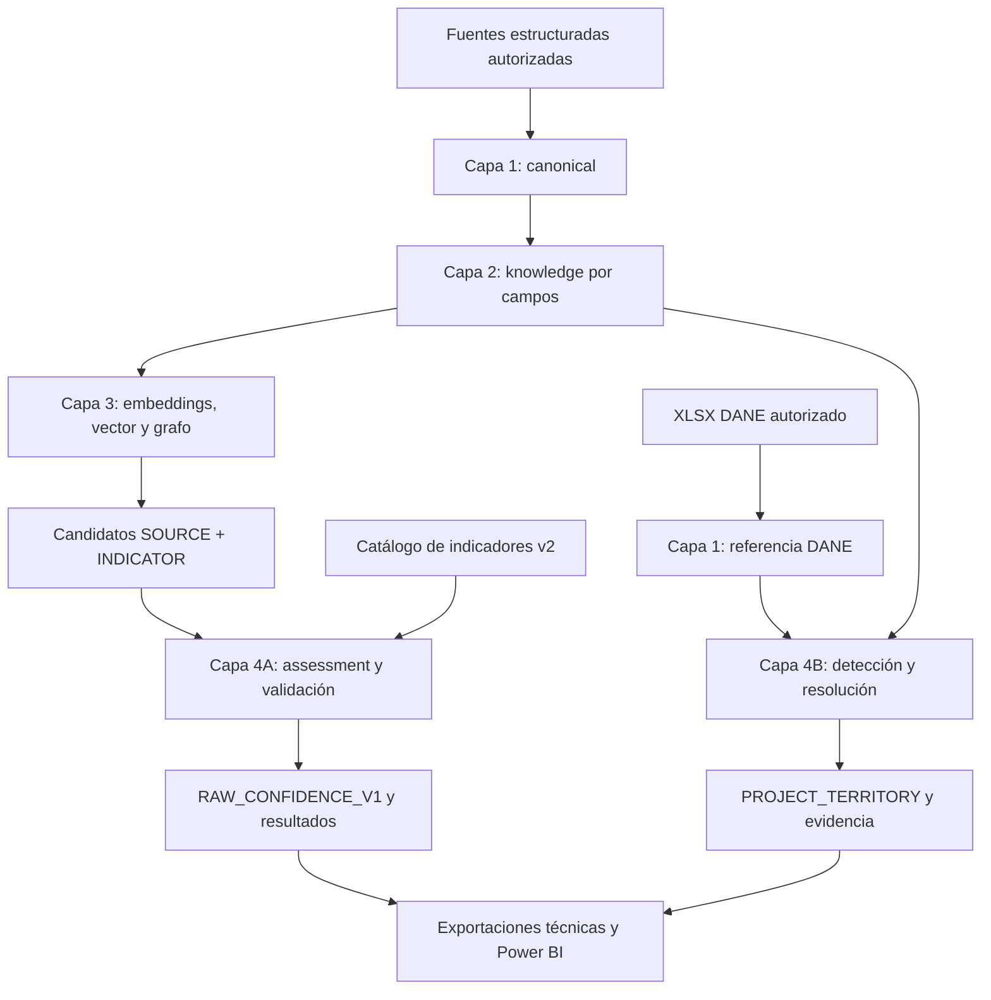

# GraphRAG — analítica de investigación e impacto regional

Sistema de analítica de datos para caracterizar la actividad investigativa y su
impacto regional en la Vicerrectoría de Investigación de la Pontificia Universidad
Javeriana. Combina datos estructurados, procesamiento de lenguaje natural,
recuperación híbrida GraphRAG y evaluación de indicadores con evidencia trazable.

La organización actual de Capa 4 y la preparación de V3.3 se describen en
[outputs/layer4/README.md](outputs/layer4/README.md). La publicación oficial sigue
siendo V2; V3.3 todavía no se ha publicado. Codex CLI es la interfaz utilizada para
acceder al LLM que realiza la interpretación semántica; Python coordina y valida.

GitHub contiene código, configuración compartible, contratos, pruebas y los README
de la estructura de resultados. Los Excel institucionales, respuestas, prompts de
proyectos, autorizaciones, métricas nativas, manifiestos privados y archivos de
recuperación permanecen locales. Los README de outputs describen esos artefactos;
sus enlaces a resultados privados requieren el workspace autorizado. No se deben
forzar esos archivos a Git para hacer pasar pruebas que necesitan datos reales.

El cierre V2 usa `scripts/run_layer4_closure.py --settings config/layer4_closure_definitive.yaml`; véase el
[procedimiento único](docs/methodology/layer4_closure_v2.md). Conserva los runners
históricos y no publica resultados incompletos. La salida territorial final usa
cuatro identificadores, sin nombres; la confianza V2 y Codex CLI se mantienen.

Este README es la guía de instalación y ejecución del código actual. Los datos
institucionales y publicaciones privadas **no vienen con Git**: un clon público
permite estudiar el código y ejecutar las pruebas sintéticas, pero no reproduce
automáticamente las publicaciones institucionales.

## Arquitectura y alcance actual

El [cierre V2 de Capa 4](docs/methodology/layer4_closure_v2.md) extiende el runner
y Codex CLI existentes. El piloto fue aceptado explícitamente; el cierre mantiene
dos candidatos y fallback desactivado. **CAPA_4_COMPLETE**: veinte proyectos y
veintinueve evaluaciones válidas, con aceptación explícita y publicación verificada.
La única salida oficial es
`outputs/layer4/final/resultado_capa4.xlsx`; los informes privados de desempeño
van en `outputs/layer4/performance/`. Las entregas anteriores son históricas.

| Capa | Responsabilidad | Alcance |
|---|---|---|
| 1 — Preparación de datos | Ingesta/validación, normalización, identidad, canonicalización, calidad, trazabilidad y referencia DANE independiente | ETL canónico y constructor DANE implementados |
| 2 — Procesamiento y conocimiento | Documentos, secciones, chunks, entidades, relaciones, provenance y validación | Publicación knowledge implementada |
| 3 — GraphRAG | Embeddings locales, índice vectorial, grafo factual, recuperación híbrida y candidatos SOURCE+INDICATOR | SOURCE_INDICATOR_V1; [aceptación SOURCE-level](docs/architecture/layer3_source_level_acceptance.md) |
| 4A — Indicadores | Perfiles, assessment estructurado, confianza y resultados | Preparación y preliminar técnico implementados; **evaluación final y calibración pendientes** |
| 4B — Territorios | Detección, resolución y caracterización territorial de PROJECT | PROJECT_TERRITORY_V1; [revalidación territorial y DANE integrado](docs/status/layer1_dane_unification_acceptance.md) |

`discovery_chunk != evidence`, `retrieval_score != confidence` y
`candidate_source != indicator_match`. Un candidato recuperado **no equivale a
un indicador cumplido**. ASSESSMENT_READY expresa disponibilidad de contexto,
no una decisión; DISCOVERY_ONLY tampoco equivale a NOT_SUPPORTED.



4B recorre todos los PROJECT de Capa 2, sin consumir GraphRAG. 4A evalúa pares
PROJECT+INDICATOR en el preliminar; ARTICLE queda fuera de esa fase.
Title/keywords orientan discovery; summary, methodology, objectives y
expected_results aportan contexto sustantivo. SUPPORTED requiere citas sustantivas
verificables. RAW_CONFIDENCE_V1 mide evidencia estructurada, **no probabilidad**;
confidence_probability y confidence_level permanecen NULL.

## Requisitos e instalación

El camino verificado en el repositorio es **Windows x64, PowerShell y Python
3.14**. No se declara un mínimo alternativo soportado. La configuración de
embeddings usa CUDA, float16 y una GPU NVIDIA de 8 GiB en el entorno documentado;
otro hardware requiere validación y calibración propias.

Desde la carpeta del clon:

```powershell
py -3.14 --version
py -3.14 -m venv .venv
.\.venv\Scripts\Activate.ps1
python -m pip install -r requirements-dev.txt
python -m pip check
```

Esto instala runtime base y pytest: pandas 3.0.6, NumPy 2.5.3, PyArrow 23.0.1,
openpyxl 3.1.5, PyYAML 6.0.3, jsonschema 4.26.0 y pytest 9.1.1.
Si no puedes activar el entorno, sustituye `python` por
`.\.venv\Scripts\python.exe` en los comandos.

Para embeddings en el entorno Windows/CUDA verificado, instala **en lugar de la
lista anterior** el lock completo, que también incluye pytest:

```powershell
python -m pip install -r requirements/layer3-windows-cuda.lock.txt
python -m pip check
```

El lock fija PyTorch 2.11.0+cu128, sentence-transformers 5.2.3, transformers 4.57.6
y huggingface_hub 0.36.2, junto con sus transitivas. La lista
[requirements/layer3.txt](requirements/layer3.txt) es la alternativa de
dependencias directas para validar otro entorno; no garantiza CUDA equivalente.

**Node.js no es necesario para el ETL ni la confianza pura.** Los renderizadores
`.mjs` usan Node y `@oai/artifact-tool` instalado en un runtime externo.
No hay package.json ni versión de Node fijada en el repositorio. Los exportadores
territorial y reusable de cuatro hojas tienen fallback openpyxl; el exportador
Power BI de indicadores requiere el runtime Node/Artifact Tool.
No ejecutar `npm install` suponiendo que existe un proyecto Node local.
Consulta [requirements](requirements/README.md) y [scripts](scripts/README.md).

## Configuración y datos autorizados

Crea el mapping privado sin reemplazar uno existente:

```powershell
if (-not (Test-Path config/sources.yaml)) {
    Copy-Item config/sources.example.yaml config/sources.yaml
}
```

Edita sus rutas, hojas, delimitadores y columnas según tus fuentes autorizadas.
Las ubicaciones de la plantilla de configuración son:

| Entrada | Ubicación esperada |
|---|---|
| Descriptores de proyectos | `data/raw/proyectos/descriptores-limpio.csv` |
| Producción/artículos | `data/raw/articulos/produccion-limpio.csv` |
| Miembros/investigadores | `data/raw/investigadores/miembros-doc-limpio.csv` |
| Catálogo usado por Capas 1–3 | `data/reference/indicadores/catalogo_indicadores.xlsx`, hoja Catalogo_Indicadores |
| Catálogo enriquecido de 4A | `data/reference/indicadores/catalogo_indicadores_v2.xlsx` |
| Referencia de 4B | `data/reference/Codigos Dane/Tabla_Codigos_Dane.xlsx` |

`config/layer1.yaml` configura el ETL; `layer2.yaml` exige un manifest canonical
aprobado y mappings/chunking revisados; `layer3.yaml` fija snapshot, modelo,
ranking y publicación. `layer4_confidence.yaml` contiene pesos versionados;
`layer4_preliminary.yaml` describe la preparación deshabilitada, no constituye
autorización para ejecutar el adaptador provisional. Detalle: [config](config/README.md).

No hay claves API requeridas por el ETL, GraphRAG local, confianza o territorios;
[.env.example](.env.example) no contiene credenciales. Las variables de pruebas y
de runtimes de exportación se describen en [tests](tests/README.md) y
[config](config/README.md). Un assessment con Codex CLI sí requiere instalación,
sesión autorizada y permiso explícito para procesar los textos institucionales.

`config/sources.yaml`, `config/*.local.yaml`, datos, outputs, pesos, cachés,
logs y entornos son privados/ignorados. La configuración versionada define
políticas y snapshots aprobados: no cambies hashes ni gates para aceptar datos
incompatibles. Los manifests garantizan que no se mezclen tablas de distintos runs.

## Ejecución paso a paso

Ejecuta desde la raíz, con el entorno preparado. Las siguientes son instrucciones,
no una receta para ejecutar indiscriminadamente todas las capas. Si recibes un
snapshot oficial, omite su reconstrucción y comprueba sus manifests.

### 1. Preparar entorno y fuentes

Completa instalación y mapping anteriores. Solicita al custodio los datos o las
publicaciones completas: `data/canonical`, `data/knowledge`, `data/graphrag`
y referencias procesadas, según las capas que necesites. No uses fixtures
sintéticas para sustituir silenciosamente datos institucionales.

### 2. Capa 1 — nueva publicación canonical

**Lee fuentes institucionales; escribe staging, auditoría y reemplaza canonical
al publicar con éxito.** Conserva runs anteriores y no modifica RAW.

```powershell
python scripts/run_layer1.py --config config/sources.yaml --settings config/layer1.yaml
```

Salida: siete tablas Parquet y `data/canonical/_manifest.json`; reportes bajo
`outputs/layer1`. Para idempotencia de aceptación se necesitan dos ejecuciones
aprobadas. `verify_layer1.py --existing` comprueba esas publicaciones y escribe
reportes; **sin --existing vuelve a ejecutar el ETL dos veces**.

### 3. Capa 2 — validar y publicar conocimiento

Revisa `readiness.approved_layer1_manifest_sha256` en
`config/layer2.yaml`, junto con publication_kind, mappings_verified y
chunking_calibrated. Obtén el hash real con:

```powershell
(Get-FileHash data/canonical/_manifest.json -Algorithm SHA256).Hash.ToLowerInvariant()
python scripts/run_layer2.py --mode profile
python scripts/run_layer2.py --mode validate
python scripts/run_layer2.py --mode publish
```

`profile` lee canonical y escribe reportes; `validate` construye/valida en
memoria sin publicar; `publish` reemplaza `data/knowledge` con sus ocho Parquet
y manifest, mediante candidato y rollback. El modo por defecto es publish.
Una nueva publicación upstream exige revisar la aprobación, no copiar un hash
sin verificar contenido. Véase [arquitectura de Capa 2](docs/architecture/layer2.md).

### 4. Capa 3 — preparación, modelo y recuperación

```powershell
python scripts/run_layer3.py --mode plan
$knowledgeHash = (Get-FileHash data/knowledge/_manifest.json -Algorithm SHA256).Hash.ToLowerInvariant()
python scripts/run_layer3.py --mode approve --manifest-sha256 $knowledgeHash
python scripts/run_layer3.py --mode validate
```

`plan` solo inspecciona configuración. `approve` verifica el snapshot y
**actualiza config/layer3.yaml**. `validate` lee datos privados y escribe un
reporte; no genera embeddings.

Si faltan los pesos locales, la preparación explícita descarga BGE-M3 fijado,
inspecciona hardware, hace censo de tokens y calibra batches mediante inferencia
local. Es costosa, requiere CUDA en el camino actual y puede actualizar configuración:

```powershell
python scripts/run_layer3.py --mode setup-model
python scripts/run_layer3.py --mode build
python scripts/run_layer3.py --mode verify
```

`build` puede calcular embeddings y reemplaza la publicación `data/graphrag`;
reutiliza bundles/cache solo si son compatibles. `verify` comprueba la
publicación y escribe un reporte, sin reconstruirla. Para idempotencia se
requieren dos builds idénticos y `--mode compare`, que escribe su informe.

Consulta híbrida sobre una publicación existente:

```powershell
python scripts/run_layer3.py --mode query --query "restauración ambiental y biodiversidad" --retrieval-mode hybrid
```

La consulta puede necesitar el modelo para embebir el query; guarda contexto
privado en `outputs/layer3/reports`. Graph-only exige `--seed-entity` explícito.
`--mode evaluate --queries <archivo>` requiere consultas conformes al schema;
sin ground truth no acredita exactitud. Más detalle en [src](src/README.md).

### 5. Capa 4A — preparación y preliminar técnico

Con catálogo v2, referencias, publicaciones y evidencias históricas compatibles:

```powershell
python scripts/build_layer4_contracts.py --check
python scripts/build_indicator_assessment_profiles.py
python scripts/prepare_layer4_inputs.py
```

El primer comando solo comprueba contratos; el segundo escribe perfiles/reglas
y snapshots de referencia en `data/reference/processed`; el tercero escribe
metadata de preparación en `outputs/layer4/preparation`, sin seleccionar
proyectos, ejecutar LLM ni crear el workbook preliminar.

El runner provisional tiene cuatro etapas separadas:

| Comando | Efecto y requisitos |
|---|---|
| `python scripts/run_layer4_preliminary.py --prepare` | Selecciona la muestra técnica, escribe inputs/baseline e inspecciona versión/flags de Codex CLI; no hace inferencia. Rechaza un directorio preliminar ya existente. |
| `python scripts/run_layer4_preliminary.py --execute` | **Invoca Codex CLI sobre textos institucionales** y persiste respuestas/resultados; requiere autorización específica y preparación compatible. |
| `python scripts/run_layer4_preliminary.py --finalize` | Valida/exporta respuestas persistidas de un run RUNNING/BLOCKED_EXPORT; escribe resultados, sin repetir LLM. |
| `python scripts/run_layer4_preliminary.py --verify` | Comprueba un preliminar READY existente sin invocar al proveedor. |

Estas etapas están ligadas al snapshot, catálogo y manifests históricos
fijados en `preliminary.py`; no constituyen un evaluador general listo para
cualquier clon. Los flags false del YAML de preparación **no desactivan por sí
solos el comando --execute**. La implementación provisional y sus resultados
persistidos no equivalen a aceptación final de 4A, benchmark humano ni calibración.
Consulta [indicadores](src/layer4/indicators/README.md).

### 6. Capa 4B — ejecución independiente

Necesita los PROJECT de Capa 2 y el XLSX DANE autorizado. La hoja adicional
ALCANCE_NACIONAL debe declarar code,name,type con la fila textual
000,Colombia,COUNTRY. COUNTRY/000 es una convención **INTERNAL**, no un código DANE.

```powershell
python scripts/build_dane_reference.py
python scripts/run_territories.py
```

El constructor crea referencia versionada en `data/reference/processed`;
admite `--source` y `--output`. El runner publica en
`outputs/layer4/territories` y archiva la publicación previa. Procesa todos los
PROJECT por campos, con matching determinístico, sin GraphRAG, LLM o servicios.

Para aceptar una publicación nueva: conservar un baseline de integridad propio
antes del build, ejecutar dos builds idénticos y revisar QA/idempotencia.
`python scripts/territory_integrity.py` imprime el fingerprint; no lo guarda.
`python scripts/verify_territories.py` es read-only y exige el baseline
`outputs/layer4/territory_acceptance/integrity_before.json`, datos y dos builds
compatibles. **No reemplaces baselines históricos para hacer pasar un cambio.**
Detalle: [territorios](src/layer4/territories/README.md).

### 7. Resultados y exportaciones disponibles

| Resultado | Ubicación / operación |
|---|---|
| Candidatos y contexto SOURCE | `data/graphrag/retrieval/source_indicator_candidates.parquet` y `source_context_packages.parquet`; las secciones se resuelven en Capa 2 |
| Territorios resueltos, evidencia y ambiguos | `outputs/layer4/territories`; incluye `project_territories_powerbi.csv` y `revision_territorios.xlsx` |
| Preliminar técnico, si existe | `outputs/layer4/preliminary_20`; Parquet/JSONL, métricas y workbook de cuatro hojas |
| Consumo Power BI preliminar | `python scripts/export_layer4_powerbi.py`; crea `outputs/layer4/powerbi_preliminary_20`, exige preliminar verificado y Node/Artifact Tool; rechaza destino existente |
| Reparación de exportación territorial | `python scripts/export_layer4_powerbi.py --repair-territories`; **modifica artefactos existentes** bajo contratos históricos específicos; no es un paso rutinario ni recalcula assessment |
| Plantilla histórica vacía | `templates/resultado_final_indicadores.xlsx`; no es un resultado de evaluación |

La bridge territorial solo contiene RESOLVED. AMBIGUOUS conserva candidatos y
no debe cargarse como relaciones confirmadas. En Power BI, preservar IDs/códigos
como texto, incluidos ceros iniciales. El sistema exporta tablas y workbooks;
no incluye un dashboard Power BI final implementado.

## Pruebas y verificadores

`pytest.ini` agrega `src` al path y por defecto solo recoge `tests/layer1`.
Ejecuta suites por separado; algunos conftest usan nombres compartidos.
Los tests escriben temporales; ningún comando de esta sección se ha ejecutado
automáticamente como parte de la documentación.

Ejemplos ligeros, sin corpus ni modelos reales:

```powershell
New-Item -ItemType Directory -Force outputs | Out-Null
python -B -m pytest tests/layer1 -q -p no:cacheprovider
python -B -m pytest tests/layer2/test_unit.py -q -p no:cacheprovider
python -B -m pytest tests/layer3 --ignore=tests/layer3/test_integration_pending.py -q -p no:cacheprovider
python -B -m pytest tests/layer4_confidence -q -p no:cacheprovider
python -B -m pytest tests/layer4_preliminary -q -p no:cacheprovider
python -B -m pytest tests/layer4_powerbi -q -p no:cacheprovider
```

`tests/layer4_preparation` y `tests/territories` mezclan fixtures con comprobaciones
de referencias/publicaciones locales; no se consideran suites públicas autónomas.
Las integraciones de Capa 2 son opt-in con LAYER2_REAL_INTEGRATION y,
para publicación, LAYER2_VERIFY_PUBLICATION. Las de Capa 3 requieren
LAYER3_RUN_REAL_INTEGRATION y **pueden construir modelos/embeddings**.
No activarlas automáticamente. Comandos y alcance por módulo: [tests](tests/README.md).

Comprobación de contratos sin reescritura:

```powershell
python scripts/build_layer2_contracts.py --check
python scripts/build_layer3_contracts.py --check
python scripts/build_layer4_contracts.py --check
```

Los verificadores de aceptación leen datos privados/baselines: `verify_layer1.py
--existing` y `verify_layer2.py` escriben reportes; `run_layer3.py --mode verify`
también. `verify_territories.py`, `run_layer4_preliminary.py --verify` y
`auxiliary/verify_layer4_preparation.py` verifican publicaciones existentes sin
reabrir sus cierres. Algunos fingerprints históricos pueden bloquearse ante
cambios legítimos del código; no alterarlos para simular aceptación del código nuevo.

## Estructura y navegación

```text
GraphRag/
├── src/           Implementación activa por capa
├── scripts/       CLI operativos y auxiliary/
├── tests/         Pruebas sintéticas e integraciones locales
├── schemas/       Contratos JSON de datos e intercambio
├── config/        Políticas versionadas y mapping privado
├── requirements/  Dependencias de embeddings y lock Windows/CUDA
├── docs/          Arquitectura, contratos, actas e índices
├── templates/     Plantilla vacía histórica autorizada
├── data/          Inputs y publicaciones privadas
└── outputs/       Runs, reportes, modelos y exportaciones privadas
```

Índices: [src](src/README.md), [scripts](scripts/README.md),
[tests](tests/README.md), [schemas](schemas/README.md),
[config](config/README.md), [requirements](requirements/README.md) y
[docs](docs/README.md). [history.py](src/layer4/history.py) explica la
verificación de originales. Sus ZIP esperados bajo archives/layer4 no están
presentes en el árbol inspeccionado; deben obtenerse antes de verificaciones
históricas que los necesiten y de las pruebas de migración.

Se conservan el [RUNBOOK anterior](docs/RUNBOOK.md) y [CODE_MAP](docs/CODE_MAP.md)
como contexto de decisiones y migraciones; sus secciones históricas no sustituyen
esta guía del árbol actual. El README interno de Capa 2 está congelado: su
descripción vigente y los índices de Capa 3 están en [src](src/README.md).

No subir datos institucionales, publicaciones, tokens, logs, pesos o configuración
privada. Los locks activos y journals se inspeccionan antes de recuperar una
publicación; nunca se eliminan a ciegas.
