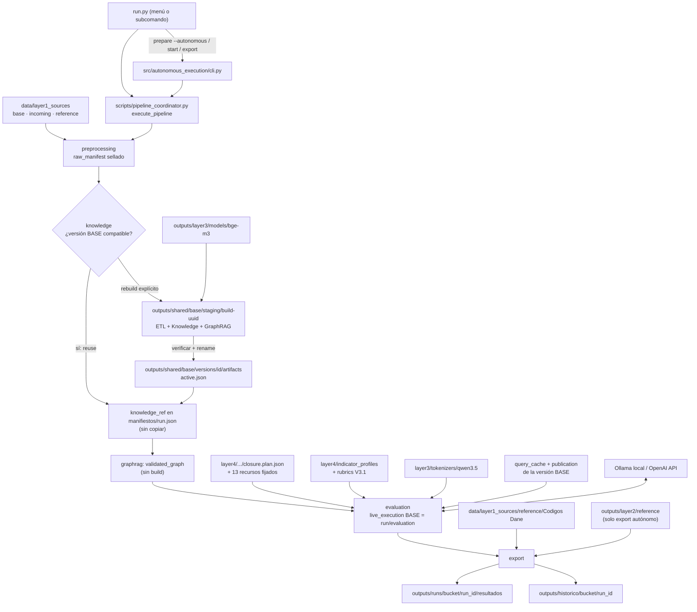
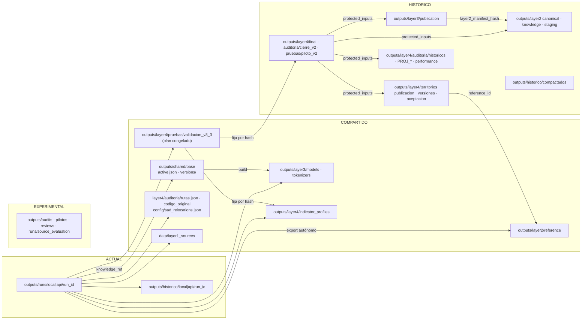

# Arquitectura vigente de GraphRag

Comprobada contra el código y la configuración el **2026-11-20**. Este documento describe qué participa
en un **run nuevo**. El catálogo estructurado de rutas está en [`catalogo_rutas.yaml`](catalogo_rutas.yaml)
y la guía de carpetas en [`outputs.md`](outputs.md). Los documentos marcados como históricos
(sección 9) describen versiones anteriores y no gobiernan el flujo actual.

Categorías usadas en toda la documentación:

| Categoría | Significado |
|---|---|
| **ACTUAL** | Código, rutas y publicaciones que el pipeline vigente usa en un run nuevo. |
| **COMPARTIDO** | Recursos sellados que varias ejecuciones reutilizan sin copiarlos (Knowledge/GraphRAG BASE, modelos, referencias, plan congelado). |
| **HISTORICO** | Publicaciones, pruebas y evidencias anteriores conservadas por trazabilidad, verificación, reproducibilidad o rollback. |
| **EXPERIMENTAL** | Componentes existentes que no forman parte del flujo operativo vigente (estudios, diagnósticos, herramientas de cierre). |

Un archivo puede ser HISTORICO y, aun así, imprescindible: un snapshot congelado que verifica un run nuevo es COMPARTIDO.

---

## Respuestas rápidas

**¿Qué está corriendo ahora?**
`uv run python run.py` (menú o subcomandos) → `scripts/pipeline_coordinator.py`. Existen dos variantes:

- `run`, `resume` y `stage` usan `execute_pipeline`.
- `prepare --autonomous`, `authorize`, `start`, `export` y `retry-pending` delegan en `src/autonomous_execution/cli.py`.

En ambas, las etapas son `preprocessing → knowledge → graphrag → evaluation → export`. La configuración por defecto es
`config/pipeline_manual.json`. Proveedores: `ollama` (`qwen3.5:4b-q4_K_M`) u `openai` (`config/openai.json`).
Modo por defecto: `PROSPECTIVE_V2` con contexto `BASE_RETRIEVED_GRAPH_V1`
(`src/layer4_evaluation/indicators/assessment_v3.py:178-181`).

**¿Qué recursos reutiliza?**
- La versión BASE activa de Knowledge y GraphRAG, `outputs/shared/base/active.json`, que hoy apunta a `d778bfa52b4c1c69-c64d8652`.
- Los pesos BGE-M3 (`outputs/layer3/models/…`) y el tokenizer Qwen (`outputs/layer3/tokenizers/qwen3.5`).
- El plan congelado V3.3 con sus 13 recursos fijados, más los perfiles y rúbricas de `outputs/layer4/`.
- El catálogo de indicadores y la tabla DANE de `data/layer1_sources/reference/`.
- El registro de reubicaciones: `outputs/layer4/auditoria/rutas.json`, `config/sad_relocations.json` y
  `docs/architecture/auditoria_consolidacion/relocations.json`. Este último es un archivo local excluido de Git;
  si no está, el resolvedor usa los otros dos registros.

**¿Dónde guarda los resultados?**
- Ejecución: `outputs/runs/<local|api>/<run_id>/` (`local` = Ollama, `api` = OpenAI).
- Copia inmutable de cada exportación: `outputs/historico/<local|api>/<run_id>/`, con `revisiones/<hash>/` y `latest.json`.

**¿Qué es histórico?**
Casi todo `outputs/layer2`, `outputs/layer3/publication` y `outputs/layer4`: la publicación oficial V2, los pilotos V2/V3.3,
los experimentos de 20 y 50 proyectos, las versiones territoriales y las auditorías. La sección 8 y el catálogo los detallan.

**¿Qué puedo ignorar para entender el sistema actual?**
- Las carpetas `outputs/layer4/auditoria/historicos`, `pruebas/piloto_v2` y `territorios/versiones`.
- `outputs/layer2/{staging,preprocessing,knowledge_artifacts}` y `outputs/layer3/{manifests,reports,quality}`.
- `outputs/audits`, `outputs/pilotos` y `outputs/reviews`.
- Los scripts `run_layer*`, `run_layer4_*`, `export_layer4_*`, `cleanup_layer4.py` y `verify_*`, junto con los documentos marcados como históricos.

**¿Qué no debo modificar?**
Ningún archivo listado en la sección 7. En resumen:
- **Por hash:** las publicaciones fijadas, el plan V3.3 y sus recursos, el Excel V2, los pesos y el tokenizer, los
  test-temp fijados por V2, las versiones territoriales y las respuestas LLM.
- **Registros:** `rutas.json`, `codigo_original/` e `inventory_*.json`, y cualquier archivo bajo `outputs/shared/base/versions`.
- **Código y configuración:** nada en `src/` ni en `config/` sin entender sus sellos, porque
  `src/layer2_processing/pipeline.py:10` sella todos los `src/**/*.py` y la identidad del Knowledge BASE depende de
  `src/layer2_processing/{preprocessing,knowledge}/`, `src/layer3_graphrag/` y `config/`. Un cambio ahí puede
  exigir reconstruir los embeddings.

---

## 1. Qué ocurre al iniciar un run nuevo

1. `run.py` interpreta el comando o el menú y llama a `pipeline_coordinator.execute_pipeline`, o bien a
   `autonomous_execution.cli.dispatch`.
2. Se asigna el `run_id` y la carpeta `outputs/runs/<bucket>/<run_id>/` (`src/run_paths.py`): `estado/`,
   `manifiestos/`, `grafo/`, `logs/`, `evaluation/` y `resultados/`.
3. Se congelan la política de evaluación y el modelo (`estado/execution.json`, `manifiestos/model.binding.json`)
   y se toma el lock `estado/.execution.lock`.
4. Se leen las fuentes RAW de `data/layer1_sources` (`raw_base`) y se sellan en `manifiestos/raw_manifest.json`.
5. **Knowledge BASE** (`knowledge_scope: BASE_GLOBAL_V1`, acción `reuse` por defecto):
   `layer2_processing.pipeline.reuse_global_base` busca una versión compatible en `outputs/shared/base/versions`
   (`knowledge_store.compatible`) y guarda solo una **referencia** (`knowledge_ref`) en `manifiestos/run.json`.
   No copia datos. Si no hay versión compatible y la acción es `reuse`, el run se detiene con el motivo; nunca
   reconstruye en silencio. Con `--knowledge-action rebuild` se construye en
   `outputs/shared/base/staging/build-<uuid>`, se verifica, se promueve por rename a `versions/<id>/artifacts` y se
   actualiza `active.json`.
6. **GraphRAG:** se valida la publicación de la versión referenciada (`validated_graph`); no se construye en un
   run de reutilización.
7. **Evaluación:** `evaluation_settings()` verifica el plan congelado V3.3 y sus 13 recursos; después se preparan
   contextos y se llama al LLM (sección 4).
8. **Exportación:** se escribe en `resultados/` y se archiva en `outputs/historico` (sección 5).

## 2. Qué reutiliza de Capa 1 y Capa 2

- **Capa 1 (RAW):** `data/layer1_sources/{base,incoming,reference}`. Solo se lee y se sella por hash. `data/raw/`,
  que citan algunos documentos históricos, **no existe**.
- **Capa 2:** el `canonical` y el `knowledge` de la versión BASE activa, en
  `outputs/shared/base/versions/<id>/artifacts/workspace/outputs/layer2/`. El run los lee en su ubicación
  (`knowledge_store.knowledge_workspace`).
- **`outputs/layer2` de la raíz no se usa** en un run BASE. Se conserva como linaje de la publicación de Capa 3 raíz
  y de V2. También sirve de *fallback* en `final_output.researchers()` para runs sin `knowledge_ref`, y
  `outputs/layer2/reference` alimenta la proyección territorial de la exportación autónoma (sección 5).

## 3. Qué usa de Capa 3

- **Publicación y `query_cache` de la versión BASE activa**
  (`…/artifacts/workspace/outputs/layer3/{publication,query_cache}`). El modo
  `BASE_RETRIEVED_GRAPH_V1` usa `scoped_retrieval.from_published_cache()`, que **no genera embeddings**: si falta
  una consulta en caché, falla con `MISSING_CACHED_QUERY`.
- **Pesos BGE-M3:** `outputs/layer3/models/bge-m3/5617a9f…`, resueltos siempre en la raíz del código y verificados
  por `weights_sha256` (`src/layer3_graphrag/embeddings.py:61-93`). Solo se necesitan para construir una versión BASE.
- **Tokenizer Qwen:** `outputs/layer3/tokenizers/qwen3.5/tokenizer.json`, fijado en `config/qwen_tokenizer.json`
  y necesario para el presupuesto de tokens (`autonomous_execution/lifecycle.py:333-336`).
- **`outputs/layer3/publication` de la raíz** (`eca9000e`, 2026-10-14) **no la consume** un run BASE. La usan las
  herramientas V2/V3.3 y los verificadores, y V2 la fija por hash.

## 4. Cómo se evalúa en Capa 4

- **Plan y criterios:**
  - `outputs/layer4/pruebas/validacion_v3_3/cierre_homogeneo_v3_3/closure.plan.json` (`live_execution.FROZEN`)
    aporta 48 perfiles, rúbricas y versiones.
  - `evaluation_settings()` exige que coincida con `closure.manifest.json` y verifica sus recursos no `.py`, que
    incluyen `final/resultado_capa4.xlsx` y `auditoria/cierre_v2/final_manifest.json`.
  - `preparation_integrity.pin()` fija `outputs/layer4/indicator_profiles/*` y las rúbricas
    `validacion_v3_3/continuacion_prompt_v3_1/rubrics.json`.
- **Motor:** `layer4_evaluation.live_execution` con `BASE = outputs/runs/<…>/evaluation`, que asigna
  `pipeline_coordinator.engine`. Sus proveedores son `ollama_provider` y `openai_provider`, con presupuesto.
  Las decisiones se toman con `prospective_v2` y `decision_v2`, y la confianza con `EVIDENCE_CONFIDENCE_SK_V1`.
  Este documento no cambia ni reinterpreta estos criterios.
- **Artículos:** `article_sources` sobre el `canonical/articulos.parquet` de la versión BASE.

## 5. Qué se exporta

- **`run` estándar** (`pipeline_coordinator.export` con el contrato `THESIS_PROSPECTIVE_ASSESSMENTS_V3` para
  PROSPECTIVE_V2, o `THESIS_VALID_ASSESSMENTS_V2` en otro caso) produce:
  - `resultados/resultado_indicadores.xlsx`, a partir de la plantilla `data/templates/plantilla_resultado_tesis.xlsx`;
  - `resultados/indicadores.csv`, `indicadores_territorios.csv` e `indicadores_territorios_relaciones.csv`;
  - `resultados/estado_indicadores.json` y `evaluaciones_validas.json`, y la carpeta `performance/`;
  - en `manifiestos/`, `export.json`, `evidence_lineage.json` y `runtime.manifest.json`.

  Los territorios salen de `indicator_csv.TerritoryCodes`, que lee la tabla DANE de
  `data/layer1_sources/reference/Codigos Dane/Tabla_Codigos_Dane.xlsx`.
- **Exportación autónoma** (`autonomous_execution.final_output`): `resultados/resultado_final.xlsx` o
  `resultado_final_indicadores.xlsx`. La proyección territorial lee y hashea **todo**
  `outputs/layer2/reference/` (`final_output.py:81`); si falta, la exportación autónoma falla.
- **Histórico:** `run_storage.archive_export` copia lo exportable a `outputs/historico/<bucket>/<run_id>/` sin
  sobrescribir nada.

## 6. Qué no se recalcula y por qué

- **Knowledge y GraphRAG:** se reutilizan mientras la identidad (RAW, catálogo, configuración de datos y código
  de Knowledge) coincida, porque reconstruir implica embeddings BGE-M3 costosos.
- **Embeddings de consultas:** se leen de `query_cache` y nunca se generan durante la evaluación.
- **Evaluaciones válidas persistidas:** al reanudar el mismo alcance, no se repiten.
- **Publicaciones V2, V3.3 y 4B:** son congeladas y se verifican; no se reconstruyen.

## 7. Dónde están los resultados oficiales

| Resultado | Ubicación | Estado |
|---|---|---|
| Resultados de cada run nuevo | `outputs/runs/<bucket>/<run_id>/resultados/` y `outputs/historico/<bucket>/<run_id>/` | ACTUAL |
| Publicación oficial Capa 4 V2 (Power BI) | `outputs/layer4/final/resultado_capa4.xlsx` (SHA `fc6f8764…`); manifiesto `outputs/layer4/auditoria/cierre_v2/final_manifest.json` | HISTORICO y COMPARTIDO: fijado por el plan V3.3 |
| Publicación territorial 4B | `outputs/layer4/territorios/publicacion/` (`PROJECT_TERRITORY_V1`) | HISTORICO; la consumen Power BI y el consumidor V3.3 |
| Contrato Power BI futuro V3.3 | `docs/contracts/layer4_powerbi_contract.md`; verificador `scripts/prepare_layer4_consumer_v3_3.py --check-only` | Preparado, no publicado |

## 8. Dónde están los experimentos históricos

Ver la sección «Publicaciones históricas» de [`catalogo_rutas.yaml`](catalogo_rutas.yaml) y [`outputs.md`](outputs.md):

- Piloto y cierre V2: `outputs/layer4/pruebas/piloto_v2/` (muestra 20, original 5, aceptado 5, preparación 20, cierre 20).
- Validación V3.3: `outputs/layer4/pruebas/validacion_v3_3/`.
- Experimento de 50 proyectos: `outputs/layer4/auditoria/historicos/experimento_50/`.
- Preliminar 20 y Power BI preliminar: `outputs/layer4/auditoria/historicos/{preliminar_20,powerbi_preliminar_20}/`.
- Demo de 30 proyectos: `outputs/layer4/final/candidatos/` y `outputs/layer4/auditoria/PROJ_*`.
- Versiones territoriales: `outputs/layer4/territorios/versiones/`.
- Runs anteriores retirados: `outputs/historico/compactados/evidencias_runs_2026-11-11.zip` (ver `docs/limpieza_outputs_2026-11-11.md`).

## 9. Componentes antiguos que no usa el flujo vigente

- **Scripts (EXPERIMENTAL o HISTORICO), que no invoca `run.py`:**
  - Ejecución y exportación por capa o estudio: `run_layer1/2/3.py`, `run_layer4_*.py`, `run_territories.py`,
    `export_layer4_pilot.py`, `export_layer4_powerbi.py`, `cleanup_layer4.py`.
  - Construcción y verificación: `build_*_contracts.py`, `build_dane_reference.py`,
    `build_indicator_assessment_profiles.py`, `verify_layer1/2.py`, `verify_territories.py`,
    `verify_layer4_pilot_delivery.py`.
  - Diagnóstico y piloto: `benchmark_scoped_retrieval.py`, `pilot_prospective_v2.py`, `evaluate_source.py`.
  - Toda la carpeta `scripts/auxiliary/`.
- **Scripts que sí usa el flujo o la administración:** `pipeline_coordinator.py`, `run_pipeline_manual.py` (wrapper
  sellado), `prepare_qwen_tokenizer.py`, `check_environment.py` (`setup.ps1`), `manage_run_retention.py` (administrativo)
  y `compare_evaluation.py` (comparaciones de `autonomous_execution`).
- **Documentos históricos**, que no gobiernan el flujo actual: `docs/architecture/cinco_capas.md`,
  `REPORTE_CONSOLIDADO_PIPELINE_5_CAPAS.md`, `pipeline_manual_auditoria.md`, `layer1.md`…`layer4.md`,
  `layer3_source_level_acceptance.md`, `docs/pipeline_manual*.md`, `docs/REPORTE_FINAL.md`, `docs/contracts/cinco_capas.md`,
  los contratos `layer4_assessment*` y los de confianza V1/V2, `docs/methodology/*` y los informes fechados de `docs/`.
  **Contratos vigentes:** `docs/contracts/final_output_contract.md` (salida de runs),
  `layer4_powerbi_contract.md` y `layer4_output_contract.md` (consumidor V3.3 preparado),
  `canonical_data_contract.md`, `layer2_knowledge_contract.md`, `layer3_graphrag_contract.md`,
  `retrieval_contract.md`, `graph_contract.md`, `chunking_contract.md` y `layer4_indicator_profiles_contract.md`.
- **Rutas citadas en documentos que ya no existen.** Esos documentos están fijados por hash, así que no se editan
  y aquí se da el equivalente vigente:

  | Ruta citada | Equivalente vigente |
  |---|---|
  | `src/layer4/…` | `src/layer4_evaluation/…`, resuelto por `config/sad_relocations.json` |
  | `tests/territories`, `tests/layer4_*` | `tests/layer5_*` |
  | `scripts/verify_layer_aliases.py`, *junctions* NTFS en `src/` | ya no existen; los sustituye el registro de reubicaciones |
  | `outputs/pipeline_manual` | `outputs/runs` |
  | `data/raw/` | `data/layer1_sources/` |
  | `scripts/run_layer4_live_demo.py` | no existe |
  | `outputs/layer3/cache` | caché opcional retirada el 2026-11-11 |

  Los comandos de `docs/RUNBOOK.md` con `--basetemp=outputs/...` ya **no funcionan**: `tests/conftest.py:11-13`
  prohíbe `--basetemp` dentro de `outputs`.

---

## Diagrama del flujo real

## Diagrama de dependencias entre carpetas

---

## Archivos que permanecen en su ubicación por compatibilidad

No se movió ningún archivo. Cada ruta de esta lista queda donde está por una dependencia comprobada:

| Ruta | Motivo |
|---|---|
| `outputs/layer2/{canonical,knowledge,reference,staging/*/run_…194411}` | Alias `data/canonical`, `data/knowledge`, `data/reference/processed` y `data/staging` en manifiestos sellados; V2 `protected_inputs`; `final_output.py:81,141-143`. |
| `outputs/layer3/{models,tokenizers,publication,query_cache}` | `config/layer3.yaml`, configuración de cada versión BASE, `config/qwen_tokenizer.json`, `output_hashes` de la publicación y V2. |
| `outputs/layer4/final/resultado_capa4.xlsx`, `auditoria/cierre_v2/final_manifest.json` | Recursos del plan V3.3, que los verifica en cada run. |
| `outputs/layer4/pruebas/validacion_v3_3/**`, `piloto_v2/cierre_20/plan.json` | `live_execution.FROZEN`, `closure.plan.json/source_hashes` y `run_layer4_definitive_v3_3.OUT`. |
| `outputs/layer4/indicator_profiles/*` | `preparation_integrity.pin()`. |
| `outputs/layer4/auditoria/{rutas.json,codigo_original/,inventory_*.json,territorial_consumption_contract.json}` | Resolución de rutas, `runtime_bindings`, `verify_layer4_layout.py` y consumo territorial V3.3. |
| `outputs/layer4/territorios/aceptacion/*-test-temp`, `auditoria/historicos/preliminar_20/test-temp` | Fijados por ruta en V2 `protected_inputs` (1.148 + 145 archivos). |
| `outputs/layer4/territorios/versiones/*`, `auditoria/pendiente_revision/*` | `inventory_before.json` / `inventory_restricted.json`. |
| `outputs/layer4/auditoria/PROJ_*`, `pruebas/*/codex_runs`, `historicos/*` | Respuestas LLM originales, no regenerables sin inferencia; evidencia de manifiestos. |
| `README.md`, `src/README.md`, `config/README.md`, `docs/RUNBOOK.md`, `docs/architecture/layer4.md`, `docs/contracts/layer4_output_contract.md` | Fijados en `runtime_bindings`, copiados en 21 workspaces, y en manifiestos de entrega o aceptación. **No se editan**; sus referencias obsoletas se corrigen aquí. |

## Propiedad de `outputs/audits` y `outputs/pilotos` (resuelto)

Las dos carpetas están registradas en `OUTPUT_DIRECTORIES` (`tests/test_output_layout.py`) con sus dueños:

- `outputs/audits`: la escriben `scripts/benchmark_scoped_retrieval.py`, `tests/semantic_validation/harness.py` e
  informes por tarea; la leen tests de validación semántica y `tests/real_runs/run_v5_openai.py`.
- `outputs/pilotos`: la escribe `scripts/pilot_prospective_v2.py`; la leen `tests/test_prospective_v2_*`.

No se movieron porque tienen consumidores en tests y scripts. Ese registro autoriza su ubicación, pero no las fija
por hash: ningún manifiesto sellado las cita y su contenido no se modificó.

Validación del 2026-11-20:
- los 9 tests de organización pasan;
- pasa la selección de 89 tests de consumidores;
- siguen sin cambios las 42/1.854 diferencias de V2 y los 32 errores de `verify_layout`, que son previos.

## Propuestas no ejecutadas (requieren decisión y revisión)

1. **Agrupar `outputs/layer4/{auditoria,pruebas}` en un área histórica única.** Es inviable sin editar `rutas.json`,
   que es entrada de la verificación de Knowledge BASE, y sin invalidar `inventory_before.json` y
   `final_manifest.json/protected_inputs`. Se mantiene la separación lógica.
2. **Candidatos de limpieza C1–C3** de la auditoría de solo lectura del 2026-11-20 (unos 65 MiB). Es un antecedente
   local: `docs/status/` está excluido de Git. Fuera de alcance: no aportan claridad
   arquitectónica y exigen archivarlos antes.
