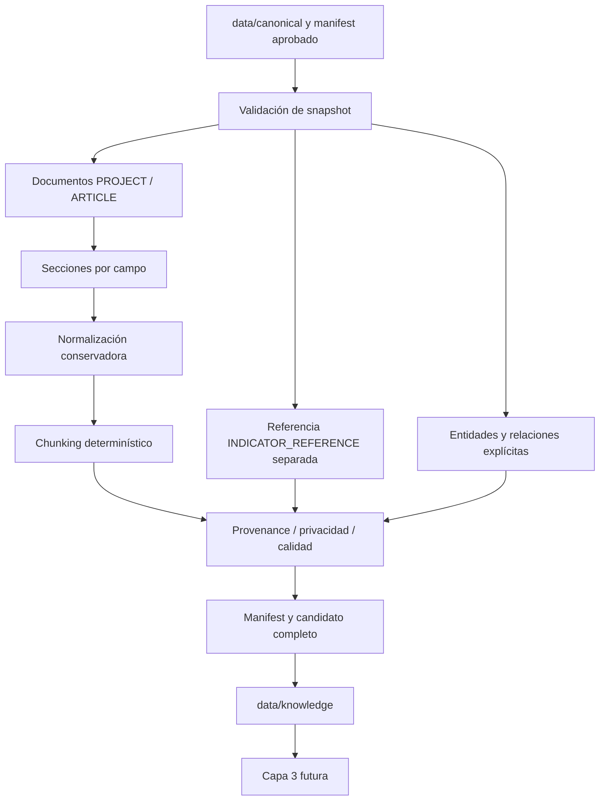

# Capa 2 — Procesamiento y conocimiento

**FINAL_PROJECT_LAYER_2_READY.** Raíz única:
`raíz local del repositorio`. Se inspeccionaron los siete Parquet
reales, se aprobó su manifest y se publicó el paquete de conocimiento tras validar
contratos, privacidad y trazabilidad. Los informes locales contienen las métricas reales.

## Aceptación real — 2026-10-05

Snapshot de Capa 1: run_20261005_194411_225750.
SHA-256 del manifest: b4484ed51f84fe2293912f4b809c554eadadd5ba18e4c991258d35d13c00b297.
Se confirmó el fin de la revisión de investigadores y el hash continuó sin cambios.

| Output | Filas |
| --- | ---: |
| source_documents | 11379 |
| source_sections | 40833 |
| source_chunks | 45362 |
| reference_documents | 48 |
| reference_sections | 192 |
| reference_chunks | 133 |
| entities | 33915 |
| relations | 24821 |

Publicaciones verificadas: run_20261005T203639_835374Z y run_20261005T204120_837354Z.
IDs y payloads idénticos en las ocho tablas; hashes físicos, schemas y roundtrip PASS.
45362/45362 chunks fuente trazables (100%); cero huérfanos, oversized o issues de
provenance/privacidad. Se conservaron tres documentos sin texto, 7214 secciones fuente
vacías y 59 de referencia; ninguna fila se inventó ni eliminó por ausencia de texto.
Duplicados exactos: 2913 chunks fuente y 85 de referencia involucrados, sin fusionar.
Se excluyeron seis emails por autorización expresa y se registraron hashes de entrada.
Los conteos de investigadores/relaciones son los de este snapshot, no contratos fijos.

Tests: 70 de Capa 1 + 51 unitarios de Capa 2 (47 originales y 4 adicionales) + 12
integraciones reales: **133 PASS, 0 FAIL, 0 SKIPPED**. Código/config/tests de Capa 1,
canonical y plantilla permanecen iguales según hashes antes/después.
Plantilla: dos hojas, 16 columnas, cero filas. Dependencias funcionales legacy: cero.
No se realizó commit/push ni se implementó Capa 3.

Evidencia: outputs/layer2/reports/acceptance.json y tests.xml; perfiles y calibración
en text_field_profile.csv, input_profile.json, chunking_candidates.json y chunking_analysis.md.
Repetir aceptación: `python scripts/verify_layer2.py` después de dos ejecuciones aprobadas.

## Fronteras

Capa 1 publica hechos, identidades y procedencia. Capa 2 prepara documentos, campos
independientes, unidades textuales y tablas de entidades/relaciones conocidas.
Capa 3 hará embeddings, recuperación, grafo y GraphRAG. Capa 4 evaluará indicadores.
Aquí no hay modelos, inferencias, indicadores asignados, scores ni resultados finales.



## Entradas y módulos

Solo se abren los siete Parquet y manifest de data/canonical de esta raíz. Nunca RAW,
staging, XLSX externos o canonical de otra raíz. Las rutas de provenance son datos,
jamás instrucciones para abrir archivos. La configuración corresponde al contrato,
diccionario y schemas físicos inspeccionados; todos los campos configurados existen.

| Módulo | Responsabilidad |
| --- | --- |
| validate_inputs | Config segura, aprobación real, schemas, claves, hashes y referencias |
| contracts | Contratos Arrow/JSON únicos para ocho outputs y manifest |
| documents | Documentos SOURCE/REFERENCE, secciones por campo y composición de referencia |
| text_normalization | Unicode NFC y formato conservador |
| chunking | Cortes jerárquicos, overlap y offsets reproducibles |
| graph_data | Entidades canónicas y dos clases de membresías explícitas, sin resolver personas |
| provenance | IDs, hashes y extensión de lineage |
| security | Exclusión de campos y detección de fugas textuales |
| quality | Métricas, perfiles y validación de cadena completa |
| pipeline | Etapas, candidato, manifest y publicación con rollback |

REQUIRED ausente/nulo o tipo incompatible produce UPSTREAM_DATA_ISSUE. OPTIONAL
ausente se registra en inspection y no crea sección. Columna existente NULL sí crea
sección vacía sin chunks. Se validan tipos Arrow, claves lógicas, filas/columnas/hashes
de manifest, run_id por registro, listas de provenance e integridad de membresías.
Los atributos NULL participan en la unicidad de relaciones. Estados resolved,
ambiguous y unresolved se conservan, sin nueva resolución de identidad.
Organizaciones sin membresías no son huérfanas: huérfano significa falta canónica.

El contrato actual usa category/dimension en indicadores y nombre oficial completo
en indicator_name. reference_attributes permite revisar mappings explícitos, sin
inventar descripciones ausentes. Área/subárea/objetivo socioeconómico son metadata
estructurada; document_type/journal son metadata bibliográfica. Cambiar esa decisión
exige revisar significado contractual. Ninguna columna se adivina por semejanza.

## Reproducción y futuras publicaciones

1. Exigir una publicación SUCCESS de Capa 1 y ausencia de .layer1.lock.
2. Inspeccionar schemas físicos, diccionario y manifest final. Confirmar publicación
   **real**, sin deducirlo de nombres o tamaño.
3. Revisar config/layer2.yaml: claves, campos, tipos, etiquetas, referencia, atributos
   y estados. Registrar publication_kind: real y approved_layer1_manifest_sha256
   con la huella exacta del manifest revisado. Si Capa 1 no declara real/synthetic,
   esto es una atestación humana explícita; no se abre su configuración de fuentes.
4. Ejecutar `python scripts/run_layer2.py --mode profile`: solo perfil real en
   outputs/layer2/reports/input_profile.json, sin publicar conocimiento.
5. Seleccionar parámetros con percentiles y revisión de textos largos/overlap/NULL.
   Aprobar mappings_verified y chunking_calibrated después de la revisión.
6. Ejecutar `python scripts/run_layer2.py --mode validate`: paquete en memoria y
   calidad, sin escribir una publicación.
7. Ejecutar integration tests reales. Resolver incompatibilidades de Capa 2 y
   reportar defectos upstream sin editar canonical.
8. Ejecutar `python scripts/run_layer2.py` dos veces, verificar payloads, manifest,
   hashes y prueba final de publicación. Recién entonces evaluar aceptación completa.

La configuración distribuida bloquea ejecución no aprobada. Manifest ausente/escritor
activo: LAYER_2_WAITING_FOR_LAYER_1 (exit 2). Aprobación/calibración pendiente o hash
cambiado: LAYER_2_CONFIGURATION_PENDING (exit 3). Error: exit 1. No hay fallback ficticio.
Una nueva publicación invalida aprobación y compatibilidad anterior; no se usa caché.

Los valores calibrados son **220/340/20**, tras comparar cinco candidatos reales.
Se conserva 95,61% de abstracts presentes sin división y el overlap añade 4,56% de palabras.
El perfil calcula count/non_null_count/null_count/empty_count y min/
mean/median/p50/p75/p90/p95/p99/max para palabras/caracteres por source_type:field_name.
Percentiles interpolan `(n-1)*p`; incluyen secciones vacías existentes. OPTIONAL
ausentes se reportan aparte. Conjuntos vacíos producen estadísticas/coverage NULL.
El umbral de documentos vacíos es 0,001 (cobertura utilizable >=99,9%); los tres
documentos actuales sin texto se conservan y reportan, sin contenido artificial.

## Texto, trazabilidad y privacidad

No se concatenan campos. keywords se representa por saltos de línea, conservando
la lista original en provenance. Cada sección conserva texto canónico previo a L2,
normalizado y hashes. Normalización no traduce, resume ni retira comillas semánticas.
Se difiere idioma: no es necesario y no se añade un modelo/confianza sin evidencia.
Detalles en [contrato de chunking](../contracts/chunking_contract.md).

Provenance extiende el origen bajo layer1, con dataset/id, run IDs, config/hash,
enlaces/hashes y proyección de los valores pertinentes de cada ocurrencia.
El provenance upstream completo no se altera: permanece en canonical y su SHA-256
exacto se registra como layer1_provenance_hash. La proyección evita copiar datos
personales y textos de otros campos a los chunks; conserva archivo/fila/hoja/mapping.
Se comprueba chunk → section → field → document → canonical → field_mapping →
original_values, con archivo/hoja/fila. Un campo textual no vacío sin mapping se
rechaza por defecto. El título enriquecido debe tener el provenance de Capa 1.
Capa 3 no necesita abrir RAW para localizar evidencia.

La deny list sensible se aplica a corpus y metadata. Identificadores técnicos no
son narrativa; institutional_id puede permanecer en metadata técnica de entidad.
Los controles mínimos impiden habilitar campos personales prohibidos por config.
Se detectan emails y valores de documentos personales presentes en canonical; los
hallazgos solo muestran object_id/motivo. El usuario autorizó explícitamente sustituir
solo emails por [EMAIL_EXCLUDED] en seis abstracts, sin tocar el resto ni canonical.
La transformación se registra con conteos y hashes de entrada. Se revisan columnas,
metadata JSON, valores originales proyectados, textos originales/normalizados y chunks.
No se publica un paquete con hallazgos residuales bajo la política activa.
Es una comprobación determinística, no garantía universal de anonimización: datos
personales en prosa fuera de esas reglas pueden requerir revisión humana.

**El paquete completo es privado:** entidades conservan nombres y claves técnicas
permitidas; la referencia documental proyectada ya excluye PII innecesaria. Indexar
solo source_chunks.text y mantener referencia
separada. No indexar JSON de provenance/metadata ni etiquetas personales. La exclusión
del corpus no anonimiza el paquete de auditoría.

## Calidad y manifests

Reportes publicados: summary.json; CSV empty_sections, duplicate_chunks,
oversized_chunks, provenance_issues, orphan_entities, orphan_relations,
excluded_sensitive_fields, pii_findings y privacy_structure_issues, con encabezados
incluso sin casos. Duplicados exactos se reportan por hash/scope
sin fusionar textos. Palabras de chunks incluyen overlap; no son volumen único.
Manifests relacionan siete entradas, manifest L1, config, código/runtime y ocho salidas.
Hashes físicos Parquet pueden variar por run_id; idempotencia compara IDs/payloads
eliminando solo campos operacionales L2. El run_id de L1 permanece en payload.

## Publicación y recuperación

Se prepara un directorio completo en outputs/layer2/runs/run_<UTC>/knowledge;
se verifica roundtrip Parquet, schemas y hashes antes del swap. La versión anterior
se archiva como previous_knowledge y se restaura ante fallo de swap/finalización.
Mismo volumen requerido. No se elimina historial ni se escribe canonical.
Lock L2 en outputs/layer2/.publish.lock; el lock L1 solo se consulta. Hashes se
verifican tras lectura y antes/después del swap. No hay transacción interproceso
compartida con Capa 1: exigir ausencia de escritor durante aceptación y validar versiones.

publication_pending.json marca un swap interrumpido y bloquea nuevos runs. Tras cierre
abrupto no consumir knowledge. Revisar candidate/destination/previous/manifest, restaurar
la última versión íntegra con operación administrativa documentada y retirar journal/lock
solo después de confirmar ausencia de procesos. No hay recuperación destructiva automática.
Los lectores deben respetar lock/journal: entre renombrados existe una ventana de ausencia.
El swap no es atómico para lectores que ignoren el protocolo.
Manifest y calidad archivados son autoridad; quality/ es una vista de conveniencia.
Cada run de publicación archiva también el YAML exacto usado, vinculado por hash,
para reproducir los mappings y decisiones de transformación sin depender de una config editada.
Si falla su copia tras publicar se informa y se conserva el reporte del run.
Un intento fallido de publicación deja failure.json y manifest FAILED, nunca SUCCESS publicado.

## Tests y dependencias

No se modifican requirements.txt, pytest.ini ni archivos de Capa 1. La aceptación
incluye su suite completa y las pruebas técnicas y reales de Capa 2.
Dependencias directas en requirements.txt; dependencias de tests en requirements-dev.txt.

```powershell
python scripts/build_layer2_contracts.py --check
python -m pytest tests/layer2 -q --basetemp=outputs/layer2/unit-temp
# Después de revisar canonical real:
$env:LAYER2_REAL_INTEGRATION = '1'
python -m pytest tests/layer2/test_integration_real.py -q
# Después de dos publicaciones aprobadas:
$env:LAYER2_VERIFY_PUBLICATION = '1'
python -m pytest tests/layer2/test_integration_real.py -q
```

LAYER2_CONFIG admite un config revisado alternativo sujeto a límites de rutas.
La integración no publica automáticamente. Las pruebas técnicas usan texto genérico
y mocks, sin proyectos/artículos/indicadores ficticios ni Parquet persistentes.
Las doce pruebas reales deben ejecutarse con ambos opt-in en la aceptación; sin
opt-in una ejecución exclusivamente técnica las omite intencionalmente.

El README dentro de src/layer2_knowledge es una nota congelada de la publicación
upstream, conservada por su hash de integridad. Su mención histórica de Capa 3
no describe el estado actual; la arquitectura vigente de Capa 3 está en layer3.md.
