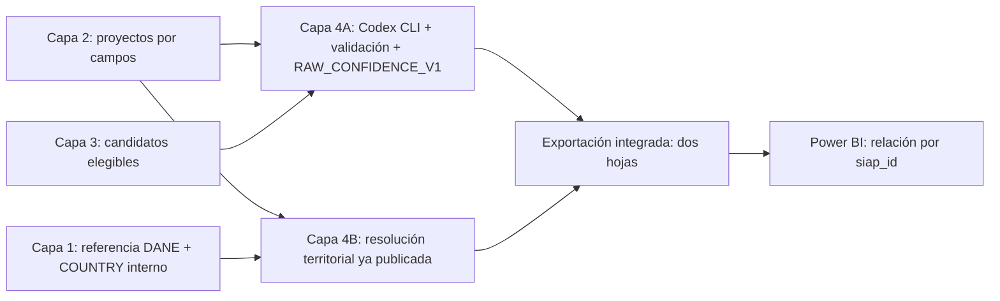
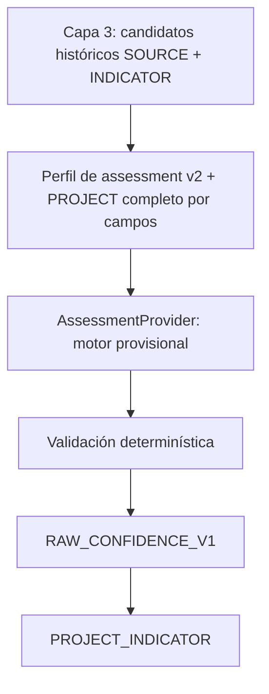
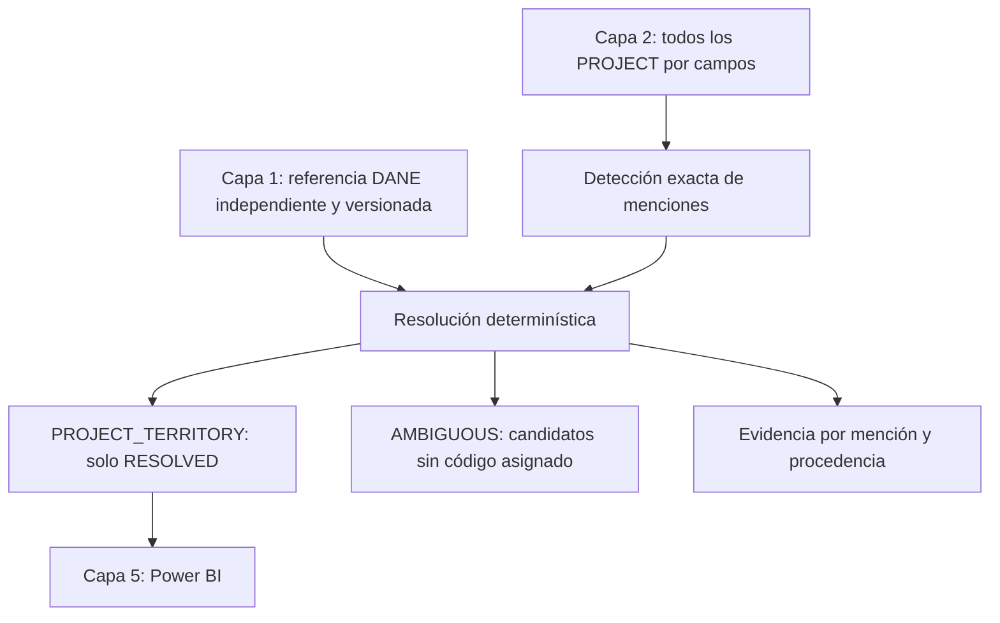

> Estado de reorganización: consultar [README operativo](../../outputs/layer4/README.md).
> V2 sigue siendo la publicación oficial; el contrato futuro de seis columnas está
> preparado, sin publicar, en [contrato de salida](../contracts/layer4_output_contract.md).
> Las secciones históricas siguientes conservan las decisiones de su versión.

# Capa 4 — evaluación y enriquecimiento

## Cierre vigente: consolidación V2

El entrypoint actual es `scripts/run_layer4_closure.py --settings config/layer4_closure_definitive.yaml`.
La publicación **CAPA_4_COMPLETE** tiene RESULTADO_INDICADORES (siete columnas) y TERRITORIOS
(`siap_id`, `territory_type`, `territory_code`, `code_system`). No se exportan
nombres en el puente ni se modifica la publicación territorial aceptada.
El fallback acotado permanece experimental y desactivado en la configuración
definitiva `config/layer4_closure_definitive.yaml`. El piloto inspeccionó trece
perfiles sin candidatos adicionales; no prueba ausencia de otros indicadores.
El mismo adaptador Codex y la fórmula V2 se conservan.

La política SEMANTIC_POLICY_V2_1 fue probada en el piloto real y el usuario aceptó
sus ocho resultados vigentes. Los veinte proyectos y veintinueve evaluaciones
recibieron aceptación final explícita del usuario, con acuerdo global 5/5,
sin atribuir veintinueve calificaciones independientes.
Los hashes originales se conservan;
las opiniones humanas editables se verifican separadamente. El procedimiento
único y las excepciones de preservación están en el documento enlazado abajo.

## Cierre V2 publicado

ASSESSMENT_V2 y EVIDENCE_CONFIDENCE_V2 utilizan el coordinador y adaptador Codex
CLI existentes. La ejecución de veinte proyectos produjo 29 pares válidos:
2 SUPPORTED, 16 INSUFFICIENT_EVIDENCE y 11 NOT_SUPPORTED, cero inválidos.
La publicación aceptada y verify-final PASS cierran esta versión. V1 y las
publicaciones anteriores se conservan como históricos.
El [procedimiento único de cierre](../methodology/layer4_closure_v2.md) documenta
auditoría, lotes, métricas, aprobación y publicación. El [contrato V2](../contracts/layer4_assessment_v2_contract.md)
separa equivalencia semántica y fidelidad literal de citas, y calcula respaldo
para los tres estados válidos sin reclasificarlos por puntuación.

La única salida oficial para Capa 5 es
`outputs/layer4/final/resultado_capa4.xlsx`, publicada tras aceptación explícita.
Los tres informes privados se generan en `outputs/layer4/performance/`.
Las estadísticas vigentes corresponden a veinte proyectos y veintinueve pares
V2 efectivos; versiones sustituidas y exploración experimental están separadas.

La capa tiene dos ramas independientes. La rama territorial no consume Capa 3.

## Antecedente: piloto integrado de cinco proyectos (19 de octubre)

La entrega histórica del piloto usa las dos ramas y conserva su cobertura
independiente. Ocho assessments reales fueron ejecutados mediante Codex CLI y
validados automáticamente; su aceptación humana sigue pendiente. Los territorios
se filtran desde la publicación RESOLVED aceptada, sin ejecutarla otra vez.

El [acta técnica del piloto](../status/layer4_pilot_real_20261019.md) conserva
estados, configuración y límites. `scripts/export_layer4_pilot.py` genera solo
`resultado_capa4.xlsx`, `resumen_resultados.md` y `README.md` en la entrega.
Los prompts, respuestas, revisión humana y auditorías permanecen privados.

## Organización activa y alcance de los fingerprints

El código activo se organiza en `src/layer4/indicators/` y
`src/layer4/territories/`. Perfiles, assessment, confidence y preliminar son
responsabilidades de 4A, con módulos separados; matching, resolución y publicación
territorial permanecen en 4B. La referencia DANE sigue en Capa 1.

La referencia se implementa en `layer1_data.dane_reference`; no hay consumidores
activos de `layer1_territories` ni de los cinco paquetes antiguos de Capa 4.
Los nombres de carpetas de schemas (`layer4_assessment`, `layer4_confidence` y
`layer4_preliminary`) se conservan como rutas de contratos, no como paquetes Python.
El [índice del código](../../src/layer4/README.md) detalla la responsabilidad de cada módulo.

Las fusiones unen configuración/cálculo de confidence, contratos de assessment/batch,
protocolo/validación y contratos/proyección territorial. No cambian schemas,
pesos, decisiones, criterios geográficos ni artefactos ya publicados.

Los manifests existentes describen código histórico. Los ZIP originales que
`layer4.history` espera en `archives/layer4/` no están incluidos en este árbol.
Cuando esos archivos se obtengan por un canal autorizado, el verificador podrá
contrastar sus bytes con los hashes almacenados; nunca sustituye un hash esperado
por el del módulo nuevo. Los baselines de una futura ejecución fijan el código
actual mediante comprobaciones estrictas en disco.

La migración estructural y las pruebas sintéticas, por sí solas, no conceden una aceptación
real. Las revalidaciones reales posteriores se registran en sus actas específicas. Las aceptaciones anteriores y sus publicaciones permanecen históricas;
un nuevo build/ejecución tendrá fingerprint propio y requerirá su QA y aceptación.
Las rutas de schemas/config/outputs y los documentos históricos no se migran.

## 4A vigente — Codex CLI y muestra de 50 proyectos

El motor de inferencia es exclusivamente Codex CLI, mediante su adaptador Python
existente. El modelo LLM ejecuta la evaluación semántica; Codex CLI es la interfaz
de ejecución y no un modelo entrenado para indicadores. El coordinador
`scripts/run_layer4_experiment.py` prepara una muestra de 50 PROJECT distintos,
con hasta dos candidatos publicados por proyecto y lotes iniciales de cinco.
No reconstruye Capas 1–3 ni modifica 4B. La bridge RESOLVED de 4B solo se lee
para la exportación. El histórico de 20 proyectos permanece separado.

Preparar, verificar, reportar y exportar no invocan LLM. `execute-batch` requiere
autorización de textos institucionales; continuar después del piloto requiere
además aprobación ligada a sus resultados. Los fingerprints fijan publicaciones,
perfiles, campos, prompts, contratos, código, configuración y binario CLI. La
reanudación reutiliza respuestas compatibles; una ejecución de resultado incierto
se detiene para revisión antes de repetir inferencia.

Detalles, límites y reproducción: [Capa 4A con Codex CLI](../methodology/layer4a_codex_50.md).

## Histórico 4A — preparación y preliminar de 20 proyectos

La preparación está implementada y su estado **LAYER4_PRELIMINARY_INPUTS_READY**
se registra en `outputs/layer4/auditoria/historicos/preparacion_inicial/preparation_acceptance.json`.
Ese estado solo acredita entradas y contratos. Existe además un preliminar técnico
persistido: 20 PROJECT, 31 assessments válidos y motor CODEX_CLI PROVISIONAL,
según `outputs/layer4/auditoria/historicos/preliminar_20/preliminary_summary.json` y su manifest.
No constituye aceptación final de 4A, benchmark humano ni calibración.
La unidad preliminar es PROJECT+INDICATOR; ARTICLE queda fuera de esta fase.

El [catálogo enriquecido v2](../contracts/layer4_indicator_profiles_contract.md)
proporciona 48 perfiles operacionales versionados y 12 reglas RULE_TEXT.
Todos tienen elementos clave; sus fuentes_relevantes son prosa y no se convierten
en preferencias semánticas: los 48 mappings son UNMAPPED y
`preferred_evidence_fields=[]`. Para un SUPPORTED válido, sin preferencias,
un campo sustantivo verificado obtiene F=1.00 según RAW_CONFIDENCE_V1.
Las reglas RULE_TEXT se preservan como guías; no se afirman implementadas.
Los seis campos PROJECT permanecen separados:
title, keywords, summary, methodology, objectives y expected_results.

La reserva PENDING_GROUP_REVIEW de la publicación histórica de Capa 3 permanece
congelada y describe los perfiles de retrieval de esa versión. R8 usó el
catálogo anterior; Capa 4A usa catalogo_indicadores_v2.xlsx para assessment.
Los 48 IDs históricos tienen correspondencia en v2. Se registran por separado
retrieval_indicator_version y assessment_indicator_version/hash. No se cambian
REFERENCE, queries, embeddings, ranking, código ni manifests de Capa 3.
Los discovery chunks orientan, no prueban cumplimiento; no se repite retrieval.

El [contrato de assessment](../contracts/layer4_assessment_contract.md) define
SUPPORTED (strength 3–4), INSUFFICIENT_EVIDENCE (1–2) y NOT_SUPPORTED (0).
NOT_SUPPORTED no exige contradicción: significa no soportado con la información
disponible. Las citas deben existir literalmente tras NFC/whitespace conservador.
Una cita inválida produce INVALID_ASSESSMENT; no se corrige ni compensa con score.
SUPPORTED exige al menos un elemento clave literal del perfil y una cita en
summary, methodology, objectives o expected_results; title/keywords no bastan.

Confidence está en `layer4.indicators.confidence`:
RAW_CONFIDENCE_V1 = 100 × (0.35K + 0.30F + 0.20C + 0.15S). Solo SUPPORTED válido
y computable obtiene raw score. Probability/level permanecen NULL; los scores
de retrieval están excluidos. No es probabilidad ni una calibración de exactitud.

AssessmentProvider es un Protocol en `layer4.indicators.assessment`. El adaptador
CODEX_CLI provisional ya existente está en `layer4.indicators.codex_cli`; no se
declaran proveedores adicionales implementados. `config/layer4_preliminary.yaml`
mantiene los flags de preparación deshabilitados, planned_project_count=20 y
máximo dos candidatos por proyecto. Su metadata de preparación usa project_count=0;
no describe ni invalida el preliminar persistido. El runner tiene etapas CLI
explícitas independientes: `--prepare`, `--execute`, `--finalize` y `--verify`.
Solo `--execute` invoca el proveedor; requiere autorización para procesar los textos.
`--finalize` valida/exporta respuestas guardadas y `--verify` comprueba resultados
existentes sin ejecutar assessment.

### Salidas técnicas y de consumo

El [generador reusable](../contracts/layer4_output_contract.md) produce PROYECTOS,
INDICADORES, TERRITORIOS y METADATA. El workbook técnico histórico se conserva en
`outputs/layer4/auditoria/historicos/preliminar_20/resultado_preliminar_20_proyectos.xlsx`:
20 proyectos únicos, 31 assessments y 17 relaciones territoriales. Los artefactos
técnicos conservan evidencias, validación, K/F/C/S y metadata del motor.

La proyección Power BI existente está en
`outputs/layer4/auditoria/historicos/powerbi_preliminar_20/resultado_indicadores_powerbi.xlsx`,
con exactamente dos hojas. RESULTADO_INDICADORES tiene las columnas
`siap_id`, `indicador_id`, `estado_cumplimiento`, `parrafo_evidencia`,
`fuente_evidencia`, `ubicacion_evidencia` y `confianza`. TERRITORIOS tiene
`siap_id`, `territory_type`, `territory_code`, `territory_name`,
`department_code`, `department_name` y `code_system`. Los IDs institucionales
se obtienen de metadata_json.source_project_id de Capa 2; no se deducen quitando
prefijos. Las decisiones y confidence se copian sin recalcularlos.

`scripts/export_layer4_powerbi.py` crea inicialmente la tabla de indicadores;
`--repair-territories` completa en el mismo archivo los territorios ya publicados.
Esa corrección está restringida a esta muestra histórica de 20/31/17, no es un
exportador final genérico. La hoja territorial excluye AMBIGUOUS y conserva los
códigos como strings. Estas rutas son outputs privados, no archivos distribuidos
con GitHub; no se reconstruyen para instalar el repositorio.

El benchmark antiguo permanece en `outputs/layer4/auditoria/historicos/diagnostico_pre_refactor`
como diagnóstico, sin completar ni corregir labels históricos. No hay benchmark
final ni confianza calibrada. El estado histórico
`outputs/layer4/auditoria/estado_v2.json` permanece intacto.

## 4B — territorial characterization v1

Estado: **LAYER4_TERRITORY_V1_READY**. La [aceptación del 16 de octubre de 2026](../status/layer4_territory_v1_acceptance.md)
registra la publicación histórica. La [migración de Capa 4](../status/layer4_territory_migrated_real_acceptance.md)
y la posterior [unificación DANE y revalidación territorial](../status/layer1_dane_unification_acceptance.md)
aceptaron sus respectivos fingerprints con datos reales aislados, sin reemplazar
esa publicación. La última validación conjunta registró 677 PASS; dos builds
territoriales equivalentes e idempotentes conservaron 2.232 PROJECT, 2.654
relaciones (990 MUNICIPALITY, 1.147 DEPARTMENT, 517 COUNTRY) y 757 menciones
AMBIGUOUS. Esta aceptación se limita al código y snapshots registrados;
no concede aceptación automática a un código o catálogo posterior.
El cierre final de assessment de 4A continúa pendiente.

`scripts/run_territories.py` valida el manifest SUCCESS/real, los hashes,
schemas, run IDs y claves de los dos Parquet publicados de Capa 2.
Considera todos los PROJECT (2.232 en el snapshot vigente), incluidos los que
no tienen texto o no fueron recuperados por GraphRAG. Analiza por separado
title, keywords, summary, methodology, objectives y expected_results.
No concatena ni modifica textos y no analiza ARTICLE en esta versión.

El matching usa exclusivamente los nombres de la dimensión autorizada:
normalización Unicode, tildes, caso, puntuación y espacios, con límites de
palabra/frase y preferencia por nombres largos. Mantiene matched_text original,
normalized_match, offsets, project/document/section IDs y field_name.
No hay fuzzy matching, modelos, embeddings, geocoding, API ni LLM.

La resolución aplica nivel explícito, unicidad compatible y contexto
departamental dentro de la misma oración y campo. Sin una pareja explícita,
exige un único departamento contextual inequívoco a no más de 250 caracteres;
una lista con varios departamentos no elige arbitrariamente uno de ellos.
Las estructuras X,Y y X(Y)
aportan contexto. Los nombres compartidos entre niveles requieren nivel explícito
o pareja local, no mera coocurrencia. Un contexto contradictorio no elige códigos.
Los casos AMBIGUOUS conservan candidatos completos alineados y dane_code NULL;
pueden tener un candidato cuando el nivel explícito es incompatible con él.

Las guardias léxicas se aplican por igual a todos los proyectos, sin reglas por
project_id: nombres que también son sustantivos/apellidos requieren señales
geográficas más explícitas. Se excluyen menciones institucionales, personas,
accidentes geográficos y subdivisiones menores cuando su sintaxis indica ese
uso. Regiones amplias no se expanden. Por ejemplo Magdalena Medio no se convierte
en Magdalena; Norte de Santander no se trunca a Santander ni obtiene un alias
ausente del catálogo. Estas reglas priorizan precisión; pueden omitir lugares
reales sin contexto suficiente. Los porcentajes describen menciones detectadas,
no recall ni exactitud contra ground truth humano.
Las tasas principales usan evidencia publicada + AMBIGUOUS como denominador,
excluyendo menciones nacionales suprimidas. Las métricas `all_*` incluyen esas
menciones nacionales resueltas para permitir revisar también la tasa global.

El municipio no crea automáticamente una relación con su departamento padre.
La jerarquía está en la dimensión. La bridge tiene clave única
`(project_id, territory_type, dane_code)`; la evidencia conserva todas las menciones.
La tabla maestra PROJECT permanece intacta.

### Colombia 000

COUNTRY/000 es una extensión definida por el usuario y diferenciada de DANE.
En el contrato de consumo se declara explícitamente `code_system=INTERNAL`.
`000` no es un código DANE oficial. `territory_code` copia el dane_code textual
de la bridge histórica sin migrar ni reescribir sus outputs. Los demás niveles
declaran code_system=DANE.
Requiere una mención explícita del país: no se usa como valor por defecto para
proyectos sin territorio. Se publica únicamente cuando el proyecto no tiene
municipio ni departamento RESOLVED. Las menciones nacionales suprimidas quedan
en `project_national_mentions.parquet`. El municipio Colombia (Huila) conserva
su código DANE y exige nivel municipal o contexto departamental compatible.
AMBIGUOUS nunca se transforma en 000. Si coexiste una mención general independiente
a Colombia, la ambigüedad subnacional se conserva en la tabla técnica y sus conteos
se reportan en el resumen técnico; la relación nacional no la sustituye.

### Publicación y revisión

`outputs/layer4/territorios/publicacion/` contiene:

- `project_territories.parquet`: bridge RESOLVED, tres columnas string.
- `project_territory_evidence.parquet`: evidencia por mención y método.
- `project_territory_ambiguous.parquet`: candidatos, sin código asignado.
- `project_national_mentions.parquet`: menciones nacionales publicadas/suprimidas.
- `project_territories_powerbi.csv`: exactamente la bridge RESOLVED.
- `territory_summary.json`: cobertura, relaciones, métodos y ambigüedad.
- `revision_territorios.xlsx`: RESUELTOS, AMBIGUOS, CATALOGO_DANE y METADATA.
- `territory_manifest.json`, `quality.json`, `idempotence.json` y vistas `qa/`.

Se construye un candidato completo y se comprueban roundtrips, hashes, claves,
catálogo, offsets, CSV, workbook e invariancia de inputs antes de publicar.
Un lock exclusivo impide escritores concurrentes. La publicación previa se
archiva en `outputs/layer4/territorios/versiones/`; un fallo de swap restaura la anterior.
Los candidatos fallidos se conservan para diagnóstico. Ante cierre abrupto,
inspeccionar lock y directorios antes de recuperar; no borrar locks de procesos vivos.
Dos builds idénticos deben conservar todos los payloads/IDs y métricas; fecha,
metadatos del XLSX y hashes físicos operacionales pueden variar.

El workbook es una vista de revisión sin macros ni fórmulas. Los códigos son
texto. Cada relación muestra hasta tres contextos, el total de menciones y todos
los campos fuente; la evidencia completa reside en Parquet. Las celdas que excedan
el límite de Excel se abrevian con aviso. El exportador usa Artifact Tool local si está
disponible (`TERRITORY_ARTIFACT_RUNTIME`); si no existe, usa openpyxl instalado,
sin descargas. Capa 5 consumirá la bridge y la dimensión con dane_code textual
en Power BI; no cargar AMBIGUOUS como relaciones resueltas.

La evidencia privada de aceptación, muestras e integridad antes/después está en
`outputs/layer4/territorios/aceptacion/`. No debe subirse a Git.
La publicación histórica SOURCE_INDICATOR_V1, sus embeddings y código de Capa 3
no se consumen ni modifican. Esta rama no cambia la aceptación histórica.

FUTURE CONSIDERATION: si la proporción o importancia de AMBIGUOUS resulta
significativa, se podrá evaluar posteriormente una LLM restringida únicamente
a seleccionar entre candidatos DANE existentes. Esa fase no está implementada;
se decidirá después de revisar las métricas y los casos reales.

## Entrypoints y verificadores

Los entrypoints operativos permanecen en la raíz de `scripts/`:
`build_indicator_assessment_profiles.py`, `prepare_layer4_inputs.py`,
`run_layer4_preliminary.py`, `export_layer4_powerbi.py`, `run_territories.py`,
`verify_territories.py` y `build_layer4_contracts.py`. Sus comandos y efectos
están en el [índice de scripts](../../scripts/README.md).

`scripts/auxiliary/verify_layer4_preparation.py` reproduce la aceptación histórica
de preparación; no evalúa proyectos ni certifica el cierre final de 4A.
`scripts/auxiliary/create_source_level_review_workbook.py` es una herramienta de
revisión de candidatos, no una etapa de assessment ni resolución territorial.
Las verificaciones que exigen código histórico necesitan sus bytes originales;
sin los ZIP correspondientes deben bloquearse, sin reemplazar hashes ni reconstruir
publicaciones para hacerlas pasar. Las actas conservan las rutas del código que
realmente ejecutaron.
