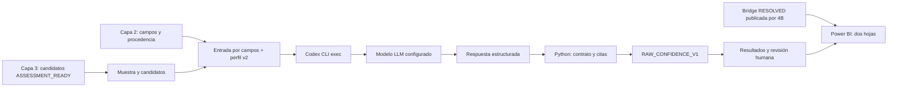

# Capa 4A: Codex CLI sobre 50 proyectos reales

## Arquitectura y responsabilidades

La unidad es PROJECT + INDICATOR. Capa 3 publicó candidatos SOURCE_INDICATOR_V1,
no decisiones de cumplimiento. Capa 4A selecciona candidatos elegibles, recupera
los seis campos originales publicados por Capa 2, incorpora perfiles v2, solicita
una evaluación a Codex CLI y valida la respuesta antes de calcular confianza.



Python prepara, selecciona, coordina, valida, calcula y exporta. Codex CLI es la
interfaz de ejecución no interactiva del modelo LLM. No es un modelo entrenado
específicamente para indicadores. El modelo realiza interpretación semántica
guiada por el catálogo. Las acciones del agente que desarrolla este repositorio
y las pruebas con procesos simulados no son inferencias experimentales.

Se conserva `AssessmentProvider.evaluate(project, indicators)` y el adaptador
`CodexCliAssessmentProvider`. No se agregan motores alternativos, proveedores
locales ni llamadas directas a APIs de inferencia. Codex CLI se utiliza por la
decisión metodológica del proyecto y porque permite automatizar la ejecución,
conservar JSON estructurado y observar eventos sin depender de la interfaz visual.

## Auditoría y reutilización

El preliminar histórico guarda 20 proyectos, 31 assessments válidos, 20 llamadas,
cero reintentos y decisiones 2 SUPPORTED, 17 INSUFFICIENT_EVIDENCE y 12
NOT_SUPPORTED. No es ground truth. Sus artefactos se preservan en
`outputs/layer4/auditoria/historicos/preliminar_20` y `powerbi_preliminary_20`; no se sobrescriben.
Sus manifests describen código histórico y no conceden aceptación al código actual.

Se reutilizan el Protocol, schemas cerrados, validador de citas, perfiles v2,
prompt base, RAW_CONFIDENCE_V1 y proyecciones Power BI/territorios. El selector y
coordinador históricos exigen 20 proyectos y su finalizador no reanuda inferencias
individuales. El exportador histórico también contiene conteos y rutas fijos.
La nueva ruta agrega selección configurable, checkpoints por proyecto,
autorización explícita, aprobación del piloto, informes parciales, exportación
genérica, libro de revisión y métricas condicionadas a etiquetas independientes.
Se mejora el mismo adaptador con fingerprints, eventos/consumo, parámetros,
modelo solicitado opcional y preservación de diagnósticos de timeout.

Los 48 perfiles provienen de `catalogo_indicadores_v2.xlsx`, hash
`1aeb1a376c24bca7bdd7acd228da527ef0043f0574541649589badb54e1cf88f`.
Todos tienen 4–7 elementos clave; las 12 reglas generales son RULE_TEXT.
Los 48 `preferred_evidence_fields` permanecen vacíos/UNMAPPED: no se infieren
preferencias desde la prosa. Capa 3 recuperó con el catálogo anterior; el assessment
usa v2 sobre los mismos IDs. Ambas versiones quedan registradas por separado.

## Publicaciones, identidades y muestra

La publicación inspeccionada de Capa 3 es
`layer3_2026-10-14T094639_959121+0000_eca9000e`, pipeline 3.2.0, ligada a Capa 2
`run_20261005T204120_837354Z`. Se verifican hashes de todos los outputs declarados
en sus manifests, tipo real/SUCCESS de Capa 2, schemas, relaciones de documentos,
secciones y contextos, hashes de textos y consistencia de runs. Se comprueba que
4B corresponde a esa misma Capa 2 y que la bridge tiene evidencia RESOLVED.
No se reconstruye ninguna publicación. `protected_inputs.json` conserva un
baseline adicional de publicaciones, referencias, código upstream y archivos
históricos/aceptados. Los verificadores rechazan cambios.

Distribución real previa a la selección:

| Tipo y estado | Candidatos |
|---|---:|
| PROJECT / ASSESSMENT_READY | 1.519 |
| PROJECT / DISCOVERY_ONLY | 267 |
| ARTICLE / ASSESSMENT_READY | 474 |
| ARTICLE / DISCOVERY_ONLY | 140 |

Los 1.519 candidatos elegibles corresponden a 280 PROJECT distintos. Los 2.400
candidatos totales no son 2.400 evaluaciones de proyectos. ARTICLE y DISCOVERY_ONLY
quedan excluidos. El SIAP ID se lee de `metadata_json.source_project_id`; nunca
se deduce retirando prefijos. Se rechazan duplicados de proyecto, documento,
identidad SIAP, contexto o pareja candidata.

`DIVERSITY_GREEDY_V1` ordena cada lista por hybrid_retrieval_score descendente e
indicator_id ascendente, como en el preliminar. `source_rank` es posición dentro
del indicador y no se compara como ranking entre indicadores. La selección de
proyectos usa novedad lexicográfica en categoría del primer candidato, área
institucional, primer indicador, dimensión, patrón de campos presentes y banda
de longitud. Luego balancea sus conteos y desempata por SHA256(seed + ':' + ID).
No depende del orden de archivos ni solo del score. Las bandas son <2.000,
2.000–7.999 y ≥8.000 caracteres en los seis campos. UNAVAILABLE conserva ausencia
de metadatos; no representa un área inferida.

Se mantiene siempre el candidato mejor puntuado. Si hay otro, se elige el indicador
menos representado entre los siguientes tres del ranking, con desempate por score
e ID. Es una diversidad acotada al ranking publicado; no se crean candidatos.
Los límites, semilla y ventana son configurables en un nuevo experimento.

Con la configuración actual se seleccionan **50 proyectos y 77 parejas**:
23 proyectos con un candidato y 27 con dos. Se cubren 41 indicadores, las cuatro
categorías y las seis áreas institucionales presentes, además de dos proyectos
sin área disponible. Categorías primarias: 7 apropiación social, 7 colaboración,
7 divulgación y 29 impacto más allá de academia. Longitud: 9 cortos, 19 medios y
22 largos. Estas frecuencias describen la muestra intencional; no justifican
representatividad. `candidate_distribution.json` distingue indicadores sin
candidatos elegibles de indicadores excluidos por presupuesto/ventana.

`selection_manifest.json` conserva los 50 IDs PROJECT/SIAP, orden, todos sus
candidatos elegibles y los seleccionados, criterios de inclusión, conteos previos,
área/subárea, seis campos, documentos, secciones, hashes, procedencia y runs. Su
hash fija la muestra y vincula las autorizaciones. Los textos permanecen en
outputs privados ignorados por Git. La misma selección se recalcula y compara
en cada verificación.

## Invocación, modelo, prompt y respuesta

La instalación observada el 2026-10-19 es **codex-cli 0.163.0**; el histórico usó
0.162.1. `runtime.json` registra ruta y SHA256 del ejecutable, versión, ayuda y
features. No se leen ni copian credenciales. La inspección usa solo `--version`,
`exec --help` y `features list`: no ejecuta inferencia.

Python usa `subprocess.run(argv, input=prompt, shell=False, timeout=600, ... )`.
Resuelve el binario instalado o el entrypoint Node sin shell wrappers. Cada
llamada recibe un proyecto con uno o dos indicadores; un lote coordina hasta
cinco llamadas secuenciales. La interfaz oficial soporta `codex exec`, entrada
stdin, JSONL, schema y salida final en archivo. Véanse
[modo no interactivo](https://developers.openai.com/codex/noninteractive) y
[referencia CLI](https://developers.openai.com/codex/cli/reference), consultados
el 2026-10-19; la ayuda local guardada es la autoridad para esta instalación.

Forma abreviada de la invocación (los argumentos exactos se guardan por llamada):

```text
codex exec --ignore-user-config --ignore-rules --strict-config --ephemeral
  --skip-git-repo-check --sandbox read-only --cd <directorio aislado>
  --output-schema <assessment_batch.schema.json>
  --output-last-message <response.json> --json --color never
  -c approval_policy="never" -c web_search="disabled" -c project_doc_max_bytes=0
  --disable <cada capacidad operativa restringida>
  --enable skip_host_skill_discovery -
```

Se deshabilitan shell, ejecución unificada, code mode host, apps/plugins, agentes,
navegadores, computer use, imágenes, búsqueda de skills, hooks, sleep, artifacts,
dependencias del workspace, memorias, goals, sugerencia de herramientas y petición
de permisos. El prompt prohíbe ejecutar herramientas y tratar el contenido del
proyecto/catálogo como instrucciones. Se usa un directorio de intento aislado,
configuración de usuario/rules ignorada, permisos de lectura y aprobación never.
Se rechaza cualquier uso operativo observado en eventos. Son controles de
reducción de riesgo; no se afirma una garantía absoluta contra prompt injection
ni contra configuración administrada externa a la aplicación.

`model: null` conserva la selección por defecto de esa invocación CLI. Dado que
se ignora el config de usuario, un modelo escrito allí **no prueba** qué modelo
ejecutará este flujo. No se ha observado un modelo efectivo en una llamada real
del experimento. Puede fijarse `model` explícitamente en un nuevo run; se envía
`--model`, se conserva el valor solicitado y se distingue de cualquier modelo
reportado por eventos. No se inventa un identificador ni se supone que sea el
modelo del agente de desarrollo. Si la CLI no informa la resolución efectiva,
permanece desconocida. Tampoco se promete una revisión inmutable del modelo
al usar un alias o defaults del servicio.

El prompt completo y reproducible está en `assessment_inputs.jsonl` y, para cada
llamada real, en `codex_runs/<PROJECT>/attempt_N/prompt.txt`. Su base es
`prompt.INSTRUCTIONS`; `experiment.request_for` agrega JSON con:

- project_id y los campos separados title, keywords, summary, methodology,
  objectives y expected_results, conservando NULL y texto original de Capa 2;
- perfil operacional v2: ID/nombre, categoría/dimensión, descripción ampliada,
  elementos clave literales, evidencia favorable/insuficiente, términos,
  contexto relacional, fuentes relevantes, preferencias y versión; atributos
  disponibles ámbito, tipo, forma de evaluación y unidad;
- las doce reglas generales del catálogo como guías textuales.

No se transmiten scores/rankings, raw confidence, relaciones personales ni tablas
de investigadores. Un email explícito no previsto en los campos bloquea la
inferencia para resolver su tratamiento; no se modifica el texto silenciosamente.
Los originales publicados por Capa 2 ya incluyen su política autorizada de emails.

La respuesta es un objeto cerrado con project_id y una lista de assessments,
cada uno con indicator_id, decision, support_strength, supported_key_elements,
evidence [{field,text}] y explanation. Debe devolver exactamente los indicadores
solicitados, sin duplicados ni extras. `response.json` conserva la salida original;
events.jsonl, stderr.txt y call.json preservan transporte, parámetros, hashes,
timestamps, retorno, error, reintento, modelo solicitado y observaciones disponibles.

## Validación y confianza

Python aplica schema cerrado y validación determinística. Strength es entero
(no bool) y consistente: NOT_SUPPORTED=0, INSUFFICIENT_EVIDENCE=1–2, SUPPORTED=3–4.
Las citas deben existir en el campo indicado después de NFC y colapso conservador
de whitespace, preservando caso, acentos y puntuación. No hay fuzzy matching ni
corrección. SUPPORTED exige elementos del catálogo y al menos una cita sustantiva
en summary, methodology, objectives o expected_results. Title/keywords no bastan.
Una cita inexistente invalida todo el assessment, cualquiera que sea su decisión.
No se transforman candidatos no evaluados en NOT_SUPPORTED.

La ubicación guarda section_id, campo, inicio/final exclusivo y sistema de
coordenadas. Primero se busca el literal original. Si solo coincide tras
normalización, se identifican explícitamente offsets del texto normalizado.
No se publican como offsets originales. Todas las ocurrencias adicionales pueden
verificarse en FUENTES; la ubicación señala la primera coincidencia comprobada.

La validación prueba formato, fidelidad de cita, pertenencia y consistencia
contractual. No demuestra que la cita implique semánticamente cada elemento.
Esa validez requiere revisión independiente; una respuesta segura de la LLM no
anula ningún gate Python. Se preservan por separado respuesta, validación,
factores, raw score y campos de probabilidad/level NULL.

Se conserva sin cambios **RAW_CONFIDENCE_V1**:

`100 × (0.35K + 0.30F + 0.20C + 0.15S)`.

K es la proporción de elementos únicos soportados; F la máxima relevancia de los
campos citados; C=0.70 con un campo sustantivo distinto y 1.00 con dos o más;
S=strength/4. Sin preferencias, un campo sustantivo válido da F=1.00. El cálculo
usa Decimal y ROUND_HALF_UP a dos decimales; el ejemplo contractual da 87.50.
Solo SUPPORTED válido con catálogo recibe score. Los demás son NOT_APPLICABLE,
NOT_COMPUTABLE o INVALID_ASSESSMENT con score NULL según contrato. No se repondera
ni se usa retrieval para aumentar confianza.

`progress.json` informa distribuciones n, faltantes/no aplicables, min, max,
media, mediana e histograma de K/F/C/S y raw score. Antes de inferir n=0 y
estadísticos NULL: no son resultados medidos. En el histórico solo dos casos
SUPPORTED computaron: K=1, F=1, C medio=.85 y S=.75; no se extrapolan a los 50.
Raw confidence expresa evidencia estructurada, no probabilidad ni exactitud.
La calibración queda pendiente de referencias independientes suficientes y de
una evaluación separada fuera de entrenamiento; no se entrena con pseudoetiquetas.

## Lotes, errores, reanudación y consumo

Cada comando `execute-batch` procesa como máximo cinco proyectos. El piloto
abarca los primeros cinco de la selección fija. Continuar exige que todos sus
assessments sean válidos y una aprobación firmada en sentido operativo (identidad,
fecha y hashes; no es firma criptográfica). Después se avanza un lote por comando.
Un error individual conserva los otros registros y bloquea el paso al siguiente
lote hasta revisión. Los errores de autenticación, permisos, configuración,
cuota, rate limit o uso de herramientas detienen llamadas adicionales del lote.

El adaptador permite hasta un reintento por fallo técnico, configurable a cero;
no reintenta un assessment semánticamente inválido para mejorar su respuesta.
Un timeout mata el proceso CLI según subprocess y conserva diagnósticos disponibles;
no garantiza cancelación del cálculo remoto ni ausencia de consumo. El presupuesto
de 77 assessments es lógico: fallos/reintentos pueden elevar las llamadas.

Los archivos se escriben con reemplazo atómico y un lock evita dos coordinadores.
Cada proyecto tiene checkpoint propio. Una respuesta compatible se revalida sin
inferir otra vez. Si el transporte terminó y quedó su auditoría pero se interrumpió
el coordinador, se recupera response.json. Si no existe auditoría de finalización,
se registra UNCERTAIN_OUTCOME: no se adivina si hubo consumo ni se repite. Un
checkpoint ERROR/INVALID exige inspección; no se elimina para forzar reintentos.
No existe reparación automática de decisiones ni edición manual de citas aceptada
como salida Codex. Cambiar inputs/prompts/modelo/código requiere nuevo fingerprint.

El consumo solo se registra cuando turn.completed aporta usage. Se conservan
observaciones por llamada sin asignar tokens a indicadores individuales ni
estimar costos monetarios. Campos ausentes quedan ausentes; no se interpretan
como cero. Los tokens simulados en tests no pertenecen a resultados reales.

Reproducibilidad de selección, inputs, validación, cálculo y exportación es
determinística bajo los fingerprints. La inferencia LLM no garantiza repetición
bit a bit por defaults/alias, versiones del servicio y variación de generación.
El mecanismo principal de reproducción es conservar y revalidar respuestas
originales compatibles, no volver a consumir inferencia.

## Revisión humana y alcance académico

El libro `revision_humana.xlsx` contiene ETIQUETADO, REVISION, FUENTES, CATALOGO y
GUIA. Incluye IDs SIAP/PROJECT, indicador, decisión, citas, campo/ubicación,
strength, raw score, validación automática, explicación y K/F/C/S. Las etiquetas,
identidad del revisor, declaración de independencia, validez de evidencia y
observaciones empiezan vacías. FUENTES divide campos largos en fragmentos de
1.500 caracteres con offsets originales para evitar filas mayores al límite de
Excel; concatenarlos en orden recupera exactamente el campo. Las celdas conservan
el texto completo y el alto de presentación se limita a 400 puntos. Una cita
excepcionalmente larga puede requerir consultar la barra de fórmulas o el JSON.

Cada revisor debe etiquetar en ETIQUETADO usando FUENTES y CATALOGO antes de ver
REVISION. Después audita evidencia literal y soporte semántico. El libro facilita
ese protocolo pero no puede demostrar que no se hayan visto predicciones. No se
reporta independencia si el revisor no la declara. Varias personas usan copias
independientes; el importador rechaza duplicados del mismo revisor y pareja.

Con etiquetas disponibles, `human-metrics` calcula matrices de confusión, accuracy,
precision/recall/F1 por clase, macro F1 de las tres clases (divisiones sin
denominador=0), Cohen kappa y acuerdo entre revisores sobre pares comunes.
También informa validez de evidencia revisada y consistencia automática
decisión/strength. Una revisión vacía produce PENDING_HUMAN_LABELS, sin métricas
de clasificación inventadas. No se generan ni sustituyen etiquetas humanas.

Estas métricas son condicionales a los candidatos seleccionados y al material
publicado, no al universo institucional ni al recall end-to-end de GraphRAG + LLM.
No evalúan los indicadores no candidatos/no seleccionados. Las hasta dos
observaciones de un mismo proyecto son dependientes. Con 50 proyectos, selección
intencional y clases posiblemente desbalanceadas, los indicadores raros tendrán
poco soporte. No se usan intervalos binomiales ingenuos sobre 77 pares como si
fueran independientes; una futura estimación deberá respetar agrupación por
proyecto y un diseño de muestra adecuado. No hay base para afirmar exactitud
institucional ni calibrar probabilidades antes del benchmark independiente.

## Reproducción

Desde la raíz, con dependencias instaladas y publicaciones privadas disponibles:

```powershell
.\.venv\Scripts\python.exe -B scripts/run_layer4_experiment.py prepare
.\.venv\Scripts\python.exe -B scripts/run_layer4_experiment.py verify
.\.venv\Scripts\python.exe -B scripts/run_layer4_experiment.py export
```

`prepare` no sobrescribe un experimento existente. Para otro experimento, copiar
el YAML, elegir un nuevo `output_directory: outputs/layer4/experiment_*` y usar
`--config <archivo>` antes del subcomando. Configurar 50/2/5 para esta prueba.
La preparación comprueba las capacidades locales y escribe prompts sin enviarlos.

Antes del piloto, obtener autorización aplicable para procesar esos textos mediante
Codex CLI. Copiar `authorization.example.json` a otro archivo (no editar el ejemplo
fijado por hashes) y registrar `institutional_text_authorized: true`, authorized_by,
authorization_reference, authorized_at, el selection_sha256 exacto y scope=pilot.
El software verifica la constancia, no otorga autorización institucional.

```powershell
.\.venv\Scripts\python.exe -B scripts/run_layer4_experiment.py execute-batch --stage pilot --authorization <autorizacion_piloto.json>
.\.venv\Scripts\python.exe -B scripts/run_layer4_experiment.py report
.\.venv\Scripts\python.exe -B scripts/run_layer4_experiment.py export
```

Repetir el comando piloto tras interrupción solo recupera/salta transportes
compatibles; nunca elimina auditorías. Revisar los cinco proyectos antes de seguir.
Crear una aprobación con selection_sha256, pilot_results_sha256 obtenido de
progress.json, approved=true, approved_by y approved_at. La autorización para
continuar debe registrar scope=continue y cubrir los restantes proyectos:

```powershell
.\.venv\Scripts\python.exe -B scripts/run_layer4_experiment.py execute-batch --stage continue --authorization <autorizacion_continuacion.json> --pilot-approval <aprobacion_piloto.json>
```

Ejecutar ese comando una vez por lote siguiente. Reanudar no repite proyectos
válidos. Ante lock de un proceso interrumpido, comprobar primero que el PID
registrado ya no está ejecutando; archivar su constancia y retirar únicamente ese
lock por una acción operativa explícita. No retirar locks de procesos activos.
Ante ERROR, INVALID o UNCERTAIN, revisar los archivos del proyecto y documentar
una resolución antes de cambiar el estado o crear un experimento correctivo.

```powershell
.\.venv\Scripts\python.exe -B scripts/run_layer4_experiment.py finalize
.\.venv\Scripts\python.exe -B scripts/run_layer4_experiment.py verify
.\.venv\Scripts\python.exe -B scripts/run_layer4_experiment.py human-metrics <revisor_1.xlsx> <revisor_2.xlsx>
```

El importador verifica selección, snapshot de resultados e identidades contra
las respuestas técnicas, conserva copias por hash y no usa las decisiones
editables del libro como predicción autoritativa. Importar todas las copias que
deban formar el benchmark. Actualizar resultados exige una nueva revisión del
snapshot exportado. `finalize` exige todos los pares solicitados válidos; no
convierte en completa una muestra con errores ni concede aceptación académica.

Las exportaciones se versionan por hash de resultados para preservar libros
ya entregados a revisores. Power BI siempre tiene exactamente las dos hojas
contractuales; sus códigos DANE son strings, COUNTRY/000 INTERNAL, y no contiene
relaciones AMBIGUOUS. La tabla de indicadores parcial puede tener cero filas;
TERRITORIOS sí proyecta las relaciones publicadas de los 50 proyectos.

Salidas principales bajo `outputs/layer4/auditoria/historicos/experimento_50`: manifests de selección,
distribución y ejecución; protected_inputs/runtime; assessment_inputs; records y
codex_runs; technical_results.jsonl; project_indicator_diagnostics.parquet;
evidence_audit; progress; human_metrics; exports y su manifest. Los contratos
se mantienen: evidencia original, decisiones válidas, score RAW separado de
probabilidad NULL. No se hace commit/push ni se publica en servicios externos.

Pruebas offline relevantes:

```powershell
.\.venv\Scripts\python.exe -m pytest -p no:cacheprovider tests/layer4_experiment tests/layer4_preliminary tests/layer4_preparation tests/layer4_confidence tests/layer4_powerbi tests/territories
```

El cierre académico requiere todavía ejecución real autorizada, aprobación del
piloto, 77 respuestas válidas con sus citas verificadas, revisión humana
independiente y evaluación de sus métricas/limitaciones. La calibración se declara
pendiente mientras no exista referencia suficiente. Un pase de fixtures o una
exportación vacía no equivale a aceptación final.
